<p align="center"></p>

<h1 align="center">World UI</h1>
<p align="center"><b>El mundo es tu interfaz.</b><br>El motor para que los agentes trabajen contigo en el mundo físico.</p>

WUI es un motor para que agentes de código (Claude Code, Codex) proyecten interfaz sobre objetos reales: una cámara
cenital le muestra la mesa al agente y un proyector común dibuja encima lo que el agente decide, todo por MCP.
No usa sensor de profundidad, marcadores ni lentes: lo que se proyecta lo ven todas las personas en la mesa, y el agente también.

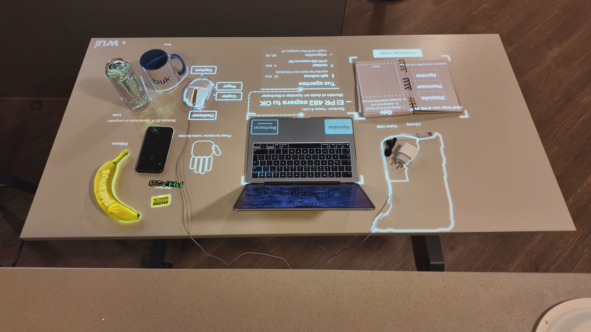

Foto real de la mesa (cámara 4K, 22-nov). Los textos se ven al revés porque están orientados hacia la persona, que se
sienta del lado opuesto a la cámara.

Proyecto del **equipo 20** en Platanus Hack 26 (track Physical World).

## Tres escenas, una mesa

| Escritorio | Sistema solar | Laboratorio |
|:---:|:---:|:---:|
| 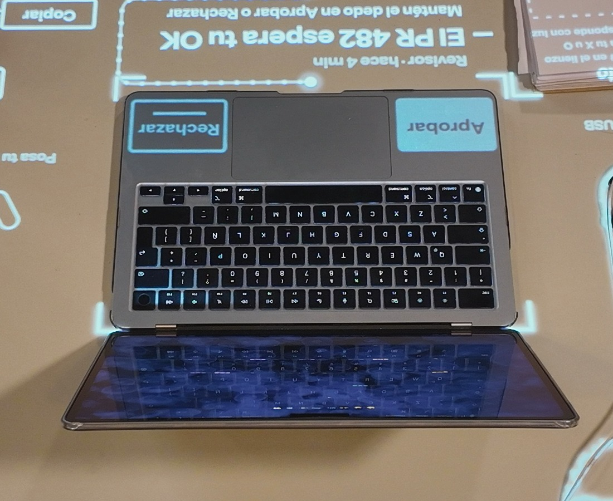 | 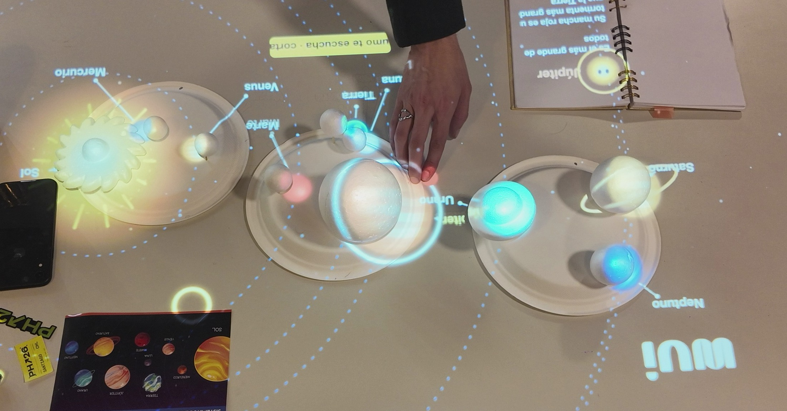 | 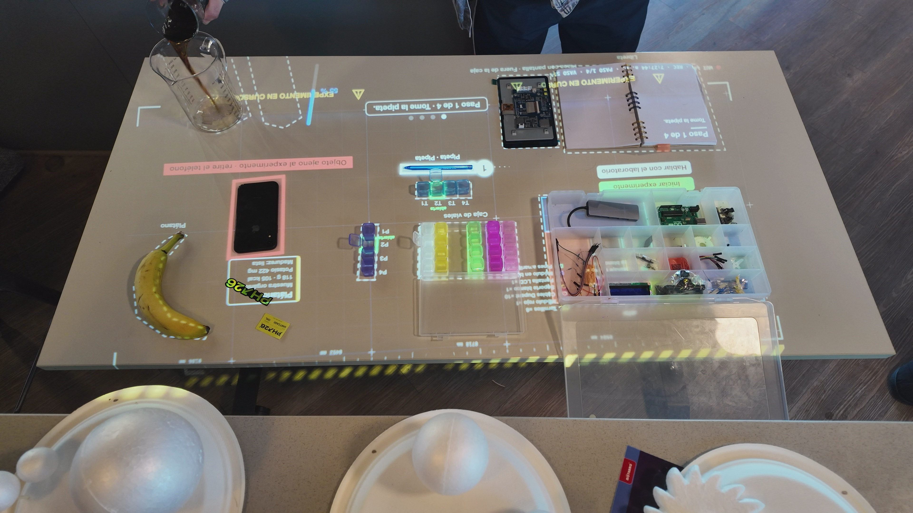 |
| Aprobar un cambio desde el reposamanos del computador. | Los planetas siguen los platos; tocar uno hace hablar a Lumo. | Pasos guiados, inventario en colores y aviso de objeto ajeno. |

Las tres son fotos reales de la cámara de la mesa, tomadas durante el hackathon. Nada de esto es el producto en sí:
son experiencias hechas con el motor, pidiéndoselas a un agente.

<p align="center">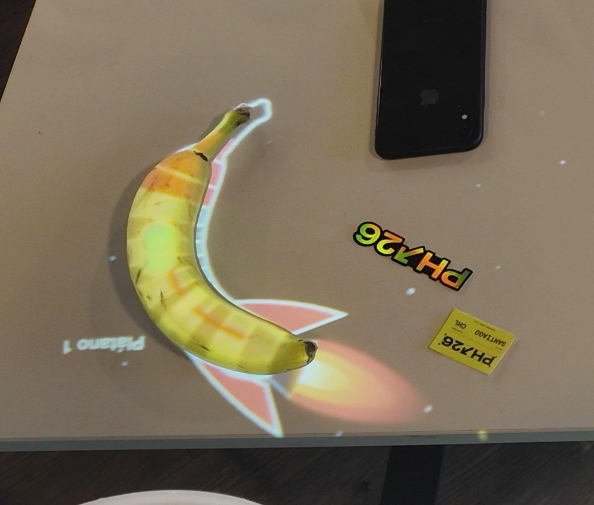 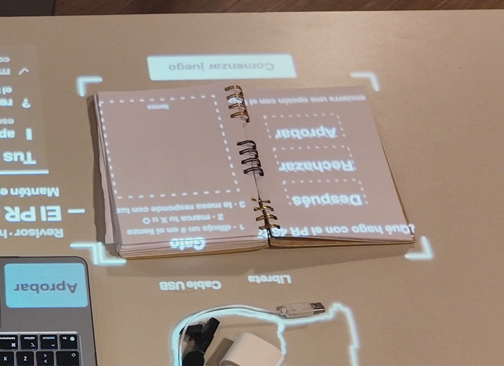</p>

## Qué se puede hacer hoy

Tres escenas corren sobre la misma mesa (1406 × 706 mm) y se encienden desde un control local:

| Escena | Qué hace | Detalle |
|---|---|---|
| **Escritorio** | Reconoce computador, libreta, lata, taza, mouse, teléfono y plátano, y le pone a cada uno su interfaz: aprobar o rechazar un cambio junto al trackpad, jugar gato con lápiz en la libreta, grabar una nota de voz posando la mano. | [ESCRITORIO.md](experimentos/v2-mesa/ESCRITORIO.md) |
| **Sistema solar** | Sigue tres platos con bolas de plumavit en tiempo real: al moverlos o girarlos, los planetas proyectados van con ellos. Tocar un planeta abre su ficha; Lumo, un agente de voz, conversa, señala y escribe en la libreta. | [SOLAR.md](experimentos/v2-mesa/SOLAR.md) |
| **Laboratorio** | Muestra el inventario de una caja organizadora, guía un protocolo paso a paso, sigue la pipeta, mide el nivel de un vaso y avisa si aparece un objeto ajeno (un teléfono). Una voz formal acompaña el trabajo. | [LAB.md](experimentos/v2-mesa/LAB.md) |

Además, cualquier agente conectado por MCP puede mirar la mesa (`look`), proyectar widgets (`project`) y esperar toques
(`events_wait`) sin usar ninguna de las escenas: ver [skills/wui/SKILL.md](skills/wui/SKILL.md).

## Un motor, no una demo

WUI es la capa que le falta a un agente para trabajar sobre una mesa real. Las tres escenas de arriba se armaron con
estas piezas, y cualquier otra experiencia se arma igual.

| Pieza | Qué le da al agente | Con qué está hecho |
|---|---|---|
| **Sesión por MCP** | Mirar la mesa, proyectar y esperar toques desde Claude Code o Codex: `look`, `project`, `remove`, `events_wait`, `calibrate`, `scene` | Gateway FastAPI + consola web (`cloud/gateway`), desplegado en Render |
| **Mesa en milímetros** | Coordenadas reales: lo que proyecta cae donde está el objeto | Calibración cámara ↔ proyector en un comando (`calibrar.py`), con luz estructurada para objetos con altura |
| **Percepción abierta** | Qué hay y dónde, sin entrenar nada | Grounding DINO (detección por texto) + Segment Anything (máscaras) |
| **Widgets vivos** | Interfaz en HTML proyectada, que reacciona a las manos | `wui.onHands`, `wui.emit`, `wui.onAudio`; manos con MediaPipe en el navegador |
| **Decisiones rápidas (Jev)** | Leer el mundo en medio segundo: sí/no, elegir una opción o marcar una caja sobre una imagen | Modelo de decisión Jev vía AI Gateway: lee el gato en papel, tapas abiertas, líquido en un vaso, manos sobre la mesa |
| **Seguimiento sin marcadores** | Objetos que se mueven y la luz los sigue | Formas y color con una cámara común: platos (círculo y punto), pipeta, teléfono |
| **Voz con manos** | Un agente que conversa, se deja interrumpir y actúa sobre la mesa | Agentes de ElevenLabs con herramientas de cliente (`ver_mesa`, `senalar`, `alumbrar`, `buscar`, `escribir_libreta`…) |
| **Skill de instalación** | Que otro agente instale y opere todo | [`skills/wui/SKILL.md`](skills/wui/SKILL.md) para Claude Code y Codex |
| **Control de escena** | Preparar en silencio y aparecer al instante | `mesa_ctl.py`: Terminar · Preparar · Dale, con arranque de marca |

Hardware: un proyector común y cualquier cámara. Sin sensor de profundidad, sin marcadores y sin lentes.

## Cómo funciona

| 1 · Cámara | 2 · Mesa en milímetros | 3 · Qué hay | 4 · Dónde está cada cosa |
|:---:|:---:|:---:|:---:|
| 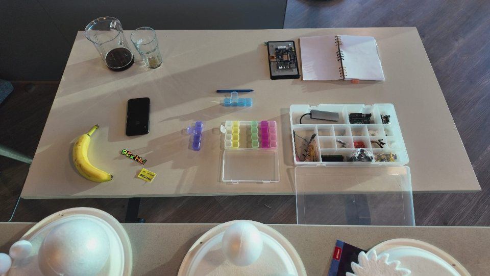 | 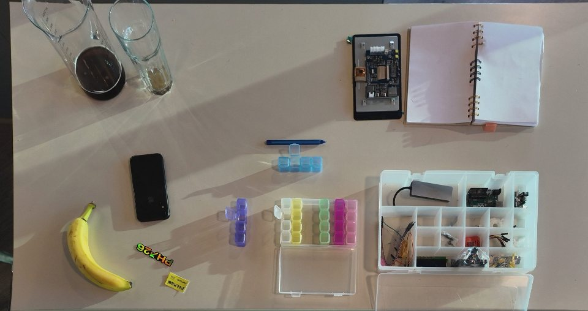 | 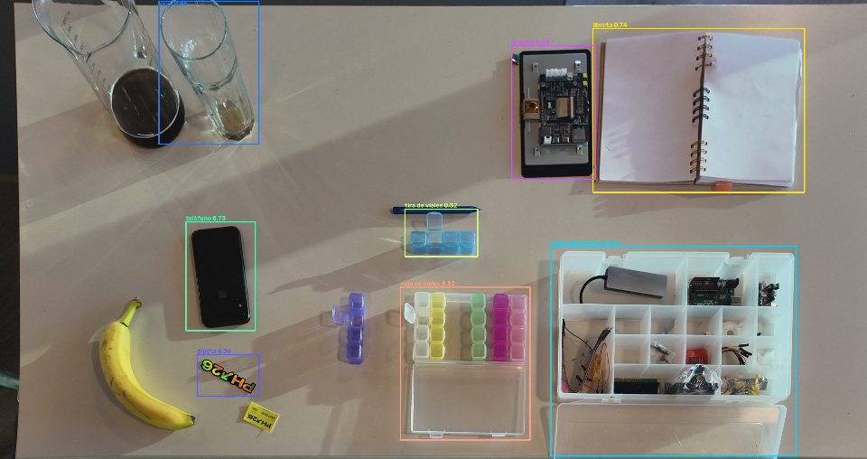 | 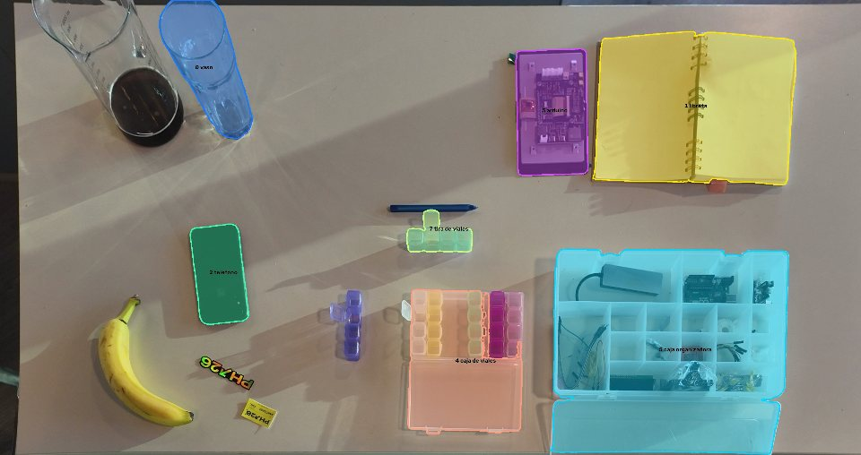 |
| Una cámara cualquiera, sin sensor de profundidad. | La calibración endereza la foto: cada píxel es un punto real. | Detección abierta, sin entrenar nada. | Segment Anything recorta cada objeto. |

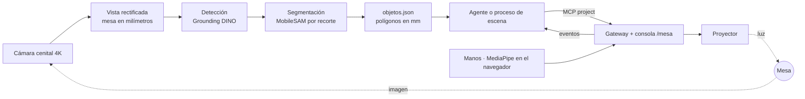

- **Cámara → mesa en milímetros.** Una calibración de unos dos minutos relaciona cámara, proyector y mesa. La escala
  real sale de los bordes del tablero y de un teléfono de tamaño conocido puesto sobre la mesa. Desde ahí todo se mide
  en milímetros reales.
- **Detección y segmentación.** Grounding DINO propone cajas a partir de una lista de nombres; MobileSAM recorta cada
  objeto por separado y entrega su silueta como polígono en milímetros.
- **Encaje sobre objetos con altura.** Un escaneo de luz estructurada mide, punto por punto, a dónde debe apuntar el
  proyector para iluminar cada parte de un objeto alto (taza, lata, mouse, plátano), en vez de suponer su altura.
- **Agente → proyector.** El agente (o el proceso de una escena) manda widgets por MCP; el más usado es un widget
  `html` cuyo script recibe las manos y emite eventos.
- **Manos.** MediaPipe Hands corre en la pestaña de la consola. Posar la mano o dejar un dedo quieto sobre una zona
  cuenta como toque.
- **Jev.** Un modelo de decisión rápido responde preguntas puntuales sobre recortes de la imagen: si hay una mano
  sobre la mesa, qué hay dibujado en la libreta, si el vaso tiene líquido.
- **Voz.** Dos agentes de voz de ElevenLabs (Lumo y el del laboratorio) conversan y usan herramientas que actúan sobre
  la proyección.

Más detalle: [docs/maestro/ARQUITECTURA.md](docs/maestro/ARQUITECTURA.md) y [docs/maestro/PIPELINE.md](docs/maestro/PIPELINE.md).

## Hardware

- Un proyector común, conectado como segunda pantalla.
- Una cámara que mire la mesa desde arriba. La demo usa una cámara 4K; el código también acepta 1080p.
- Un computador con Chrome. Todo lo construido en `experimentos/v2-mesa` se probó solo en macOS (usa AppleScript,
  `afplay` y AVFoundation).
- Micrófono y parlante para las escenas con voz.

No hace falta sensor de profundidad ni marcadores impresos.

## Inicio rápido

Esto es lo que se hace hoy en la máquina de la demo. En una máquina nueva hay pasos previos (entorno de Python, pesos
de los modelos, cliente MCP local) que están en [skills/wui/SKILL.md](skills/wui/SKILL.md), con sus límites.

```sh
SL=~/code/platanus-hack-26/sl-scanner          # clon de sl-scanner (rama hack/daniel-mesa) con su .venv

# 1. Gateway local con la consola, y la mesa abierta en Chrome
(cd cloud/gateway && PORT=9217 PCX_OPEN_SESSIONS=1 uv run python -m pcx_gateway)
#    Chrome: http://localhost:9217/mesa → activar cámaras → lanzar proyección

# 2. Calibrar (una vez por montaje, ~2 min; necesita un teléfono de tamaño conocido sobre la mesa)
cd experimentos/v2-mesa && mkdir -p out && $SL/.venv/bin/python calibrar.py

# 3. Lanzar el control y servir el dashboard (cada uno en su terminal, desde experimentos/v2-mesa)
doppler run -p platanus-hack-26 -c dev -- $SL/.venv/bin/python mesa_ctl.py     # control en :9301
python3 -m http.server 9300 --bind 127.0.0.1                                  # dashboard en :9300

# 4. Encender una escena
curl "http://127.0.0.1:9301/start?escena=escritorio"     # o solar, o lab
curl "http://127.0.0.1:9301/fin"                         # apagar
```

En la máquina de origen la carpeta `v2-mesa` corre desde una copia fuera del repositorio, junto a `sl-scanner`; por eso
los documentos de las escenas escriben `../sl-scanner/.venv/bin/python`. Además del clon de `sl-scanner` hacen falta el
servicio de detección en `:8805` y el cliente `pcxl.py`. Operación completa y problemas conocidos:
[docs/maestro/OPERACION.md](docs/maestro/OPERACION.md).

Para solo conectar un agente a una mesa, sin las escenas, basta el gateway desplegado: abrir
`https://pcx-gateway.onrender.com/agente` y seguir los pasos.

## Mapa del repositorio

| Carpeta | Qué es |
|---|---|
| `experimentos/v2-mesa/` | Las tres escenas, el pipeline de percepción en milímetros, el control de la demo, los agentes de voz y la presentación. Es lo que corre en la demo. |
| `cloud/gateway/` | Gateway FastAPI: servidor MCP (`/mcp`), consola web (`/mesa`), ventana del proyector y sesiones. Desplegado en Render como `https://pcx-gateway.onrender.com`. |
| `node/`, `renderer/`, `contracts/` | Motor local en Rust (`pcx`): captura, manos, objetos, calibración y compositor del proyector, con contratos tipados. La demo de las tres escenas no lo usa (debe estar detenido). |
| `engine/` | Copia de `sl-scanner` de Max: luz estructurada (`slscan`), MobileSAM y más. El pipeline de la mesa importa estas piezas desde un clon aparte de `sl-scanner`, no desde esta carpeta. |
| `integrations/` | Skills y plugin de `pcx` para Claude Code, Codex y OpenCode. |
| `skills/wui/` | Skill para instalar y operar WUI con las escenas de la mesa. |
| `docs/maestro/` | Documentación maestra: arquitectura, pipeline, escenas, operación y código obsoleto. |
| `docs/` | Plan, rúbrica, arquitectura de `pcx`, e investigación. |
| `web/` | Landing. |
| `hardware/` | Rig y piezas 3D. |

Los identificadores internos siguen llamándose `pcx` (servidor MCP, paquetes, variables); WUI es el nombre visible.

## Estado y límites

Lo que sigue es lo que hay, sin adornos:

- **Es un experimento de hackathon.** El código de `experimentos/v2-mesa` se escribió entre el 21 y el 22 de
  noviembre y no tiene pruebas automáticas.
- **No es portable todavía.** Los scripts llaman a un cliente MCP (`pcxl.py`) por una ruta absoluta de un directorio
  temporal de la máquina de origen, y suponen rutas fijas para `sl-scanner` y los pesos. El detalle y lo que falta
  está en [skills/wui/SKILL.md](skills/wui/SKILL.md).
- **La calibración métrica depende del montaje.** Las esquinas aproximadas del tablero y la zona donde se busca el
  teléfono de referencia están escritas a mano en `fp_geo.py`.
- **La consola local necesita un cambio que no está en `main`** (`consola-local.patch`) para que los widgets vivos
  lean las poses del rastreador.
- **El laboratorio usa un montaje anotado a mano** (`lab-modelo.json`): si se mueve un objeto fijo hay que corregir su
  rectángulo. Solo se siguen en vivo la pipeta, las tiras de viales, el teléfono y el nivel del vaso.
- **El encaje medido sobre objetos altos vale mientras el objeto no se mueva** desde el último escaneo; después se usa
  una estimación.
- **La luz estructurada no entrega alturas métricas**: cámara y proyector están casi alineados.
- **Las manos dependen de que la pestaña `/mesa` esté a la vista.** En segundo plano Chrome la frena a un cuadro por segundo.
- **El gateway desplegado corre en un plan gratuito** que se duerme tras 15 minutos sin tráfico; la primera respuesta
  puede tardar.
- **El motor Rust y las escenas no conviven**: el motor apaga la proyección para tomar su foto limpia.

Código que quedó reemplazado o sin uso: [docs/maestro/CODIGO-OBSOLETO.md](docs/maestro/CODIGO-OBSOLETO.md).

## Equipo

Equipo 20 · Platanus Hack 26.

- Daniel Sateler
- Max Mardones
- Manuel Blanco
- Pablo
- Matilda Roberts

## Para desarrollar

- CI en cada PR hacia `main`: [`.github/workflows/ci.yml`](.github/workflows/ci.yml) (Rust, Python, contratos y web).
  Antes de commitear código Rust: `cargo fmt --all`.
- Gateway: `cd cloud/gateway && uv run pytest`. Contratos: `cd contracts && uv run pytest`. Motor: `cargo test --workspace`.
- Instalación del motor `pcx`: [docs/INSTALAR.md](docs/INSTALAR.md). Arquitectura de `pcx`: [docs/arquitectura/](docs/arquitectura/README.md).
- Nada de secretos en el repositorio. Las llaves viven en Doppler (`doppler run -p platanus-hack-26 -c dev -- …`).
- El `engine/` es un subtree de `github.com/MAXMARDONES/sl-scanner`; para traer cambios:
  `git subtree pull --prefix=engine git@github.com:MAXMARDONES/sl-scanner.git master --squash`.
