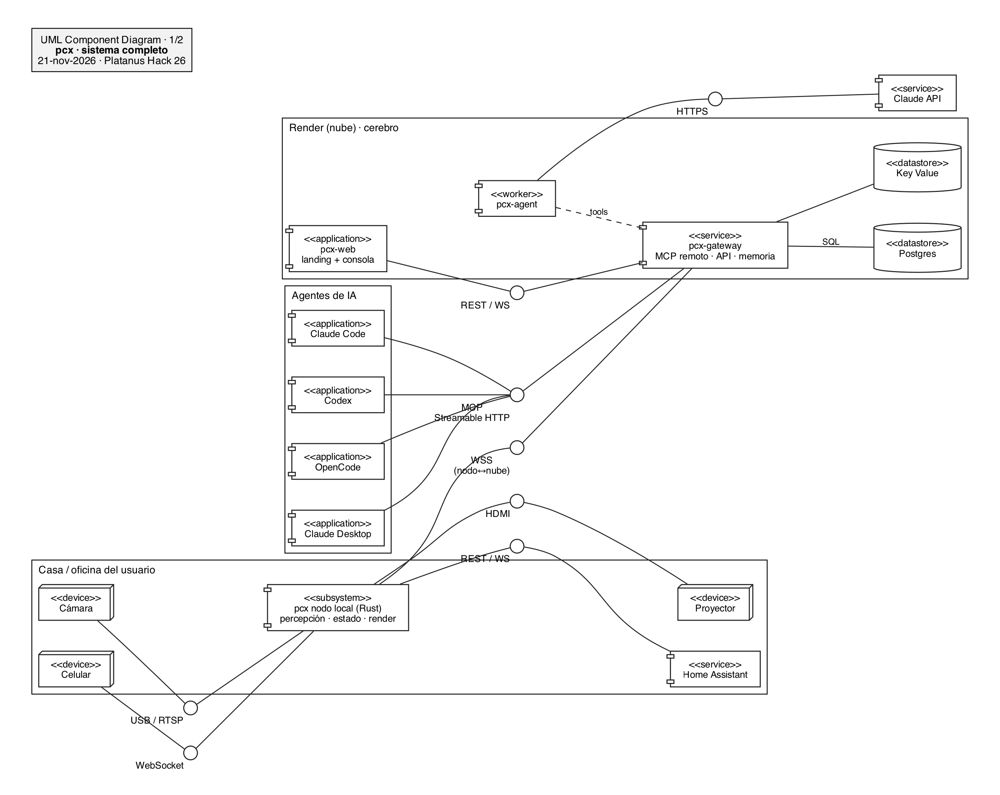
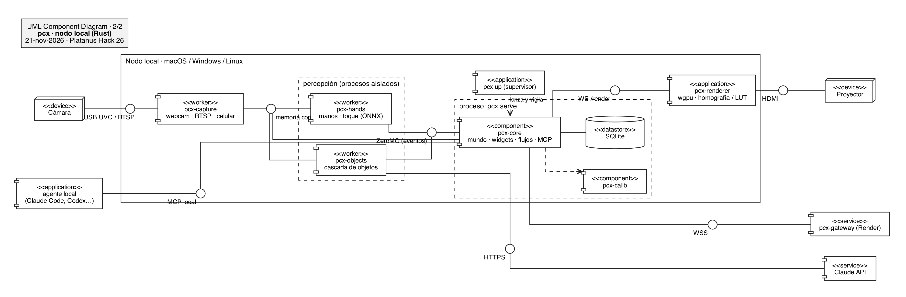

# Platanus Hack 26 — equipo

Track: **Physical World**. Proyector + cámara que entiende el espacio y lo vuelve interactivo, controlado por agentes.

Repo privado de trabajo mientras la organización entrega el oficial. Nombre de producto por definir.

## Dos versiones del engine

| Versión | Dónde | Para qué |
|---|---|---|
| **Original de Max** | `github.com/MAXMARDONES/sl-scanner` @ `b8fecff` | Es la que corre con el proyector y la cámara. No se toca. |
| **Copia del equipo** | `engine/` de este repo (subtree del mismo commit) | La que se ordena, limpia y extiende. |

Para traer cambios nuevos de Max: `git subtree pull --prefix=engine git@github.com:MAXMARDONES/sl-scanner.git master --squash`.

Cómo correr el engine: `engine/README.md` (Python 3.12 o 3.13, no 3.14).

## Plataforma pcx (rama `manu/plataforma`)

Nueva versión técnica: **contexto físico para agentes de IA**. Nodo local en Rust (macOS/Windows/Linux) + cerebro en Render + MCP para Claude Code, Codex y OpenCode. Arquitectura, decisiones y diagramas UML en [`docs/arquitectura/`](docs/arquitectura/README.md).

| Carpeta | Qué es | Cómo probar |
|---|---|---|
| `contracts/` | Mensajes tipados (Python → JSON Schema → Rust/TS), fuente única | `cd contracts && uv run pytest` |
| `node/crates/` | Nodo Rust: `pcxd` (binario `pcx`), `pcx-core`, `pcx-shm`, `pcx-capture`, `pcx-hands`, `pcx-objects`, `pcx-calib` | `cargo test --workspace` (raíz) |
| `renderer/` | Compositor del proyector (wgpu): widgets, homografía/LUT, efectos WGSL | `cargo test -p pcx-renderer` |
| `cloud/gateway/` | Gateway para Render: MCP remoto, WSS de nodos, memoria | `cd cloud/gateway && uv run pytest` |
| `web/` | Landing (Astro) con 3 propuestas de hero | `cd web && pnpm i && pnpm dev` |
| `tools/demo-techo/` | Demo calibrada en hardware real (techo con viga) | ver su README |
| `docs/pruebas/hardware-manu/` | Pruebas en hardware real: 60 fps, 215 ms de latencia, bugs | — |

## Estructura

| Carpeta | Qué va | Responsable |
|---|---|---|
| `engine/` | sl-scanner de Max: calibración, escena, efectos, API y MCP | Max (original), Manu (orden) |
| `agent/` | Ordenar el engine y conectar agentes a su API/MCP | Manu, Daniel |
| `experiences/` | Dolor elegido, casos de uso, guion de la demo, nombre y marca | Pablo, Matilda |
| `hardware/` | Rig de proyector y cámara, piezas 3D (fuentes y STL), lista de equipos | 3D |
| `docs/` | `PLAN.md` (plan vivo), `RUBRICA.md`, `CONTRATO.md`, `transcripciones/` de las conversaciones, `investigacion/` | orquestador de Daniel + todos |

## Empezar

1. Lee `docs/PLAN.md` (5 min): idea, reparto, rúbrica, feedback del mentor.
2. Lee el README de tu carpeta.

## Reglas mínimas

- `main` siempre corre. Trabajo en ramas cortas o commits chicos directos si no rompen nada.
- Nada de secretos en el repo: llaves en `.env` local (ver `.env.example`).
- El contrato entre `engine/` y `agent/` vive en `docs/CONTRATO.md`: si cambia, se avisa en el grupo.
- Cada carpeta tiene su propio README con cómo correrla.

## Fechas

- Fin del hacking: domingo 22-nov, 08:30–09:00 (por confirmar en el dashboard).
- Demo: 5 minutos.
