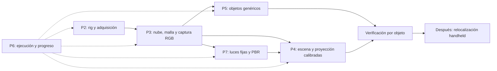

# Pipeline 3D: diagnóstico y plan P2–P7

17-oct-2026 · Codex P1, unidad h5 del orquestador Creativo. Base inspeccionada: `4512cd0` de `master`; rama `codex/p1-analisis`. Datos originales leídos desde `~/hardware/sl-scanner/captures/`, sin modificarlos.

**Resultado:** hay correspondencias cámara–proyector y un mapping 2D aprovechables, más reconstrucción y calibración probadas en sintético. Todavía no hay un rig real, una malla métrica registrada ni materiales PBR medidos. Agregar `rig.json` tampoco basta: hay que corregir la optimización, la validez de los puntos, las convenciones geométricas y la verificación física.

Mandan el [brief actualizado](BRIEF-pipeline-3d.md), [SPEC](../SPEC.md) y las correcciones de esta sesión. [PLAN](../PLAN.md) conserva decisiones históricas; sus supuestos de GPU disponible, tablero impreso y tolerancias en píxeles no acreditan el estado actual. P7 se incorpora desde el encargo, aunque el brief enumera solo P1–P6.

Correcciones incorporadas:

- **Lámparas domésticas fijas:** encender y apagar por separado; el sistema estima ubicación, intensidad y distribución de luz. No se requiere moverlas. Si la ampolleta/luminaria se ve desde la cámara del proyector, usar esa observación como restricción. El encargo de las 18:06 transmite este alcance; su procedencia está marcada no verificada y no autoriza acciones adicionales sobre dispositivos.
- **Barrido RGB y de brillo:** agregarlo a la sesión de escaneo como bloque radiométrico separado del Gray code. Sirve para respuesta de color, albedo relativo y compensación de proyección; no reemplaza diversidad de direcciones de iluminación.
- El trabajo de P1 es diagnóstico y planificación. No se operaron cámaras, proyectores ni lámparas, ni se cambió el runtime en vivo.

## 1. Evidencia reproducida

Entorno inspeccionado: Python 3.13.11, OpenCV 5.0.0, NumPy 2.5.4, SciPy 1.18.1, sin Open3D; 6,0 GiB libres al iniciar. Se reutilizó el entorno existente sin instalar paquetes.

| Entrada local | Medición de P1 | Qué permite afirmar |
|---|---|---|
| `captures/rig.json` | No existe | No hay calibración métrica de esta escena para triangular con trazabilidad |
| `scan5/osmo/map.npz` | Cámara 1080×1920; 209.504/2.073.600 píxeles válidos (10,10%); `threshold=5`, `skip_bits=2` | Correspondencias cuantizadas en bloques de 4 px de proyector |
| Coalesce de scan5 | 95.285 códigos únicos; 94.961 dentro de 1920×1080 | No son 209.504 puntos 3D independientes ni 2 millones de muestras medidas |
| Códigos fuera de imagen, scan5 | 567 píxeles de cámara; 324 códigos únicos; máximos x/y de 2046 | `Decoded.valid` solo excluye el sentinel; falta validar el tamaño del proyector |
| `scan5/proj_to_cam.npz` | 1920×1080, `valid=True` en 2.073.600 posiciones (100%) | Es un mapa interpolado, no una medición densa al 100% |
| 44 PNG originales de scan5 | Re-decode con `skip_bits=2` reproduce exactamente máscara y códigos del caché | El diagnóstico del caché es reproducible con los crudos |
| Re-decode con `skip_bits=1` / `0` | 145.702 / 23.030 válidos; dentro de imagen 145.298 / 22.933 | Recuperar bits finos con estos datos reduce fuertemente la cobertura |
| `scan5_brio/brio/map.npz` | 416.402 válidos (20,08%); 25.642 códigos únicos dentro de imagen; bloques de 4 px | Segunda vista histórica; no existe evidencia aquí de rig multicámara ni sincronía con la Osmo |
| `scan5_brio/proj_to_cam.npz` | 70,67% marcado válido | Tampoco equivale a cobertura 3D medida |
| `scan2/osmo/map.npz` | 111.447 válidos; 173 fuera de imagen; códigos módulo 4 en {2,3} | Caché histórico con convención anterior de centro de bloque; no mezclar sin migración |
| `scan5/recalib.json` | Registro histórico: 6 ArUco, 24 esquinas, mediana 1,05 px, 21 esquinas bajo 3 px | Verifica correspondencia 2D histórica, no máximo de 2 mm; no se repitió en vivo |
| `scan5/salida.json` | Corrimiento global (−21,+21) px | Hay compensación aplicada; no es extrínseco ni prueba de calibración |
| `reports/latency_osmo_proj1.json` | 1 ensayo válido de 5: 1337,2 ms; otros cuatro `null` | No hay una distribución de latencia confiable para capturar ni para handheld |

Los porcentajes de cámara incluyen todo el frame, incluso regiones ajenas a la proyección. No significan directamente cobertura de superficie. Los 94.961 códigos dentro de imagen representan el 73,27% de los 129.600 bloques posibles de 4×4, pero solo el 4,58% de los píxeles nativos como centros muestreados. Ninguna de esas cifras prueba exactitud o cobertura por objeto.

## 2. Por qué el pipeline no llega hoy al resultado pedido

### Geometría y calibración

- [`slscan/cli.py`](../slscan/cli.py), `cmd_scan`: sin `--rig` retorna después de los mapas. [`playground/recalib.py`](../playground/recalib.py) llama ese camino y genera POV, altura relativa y segmentos; no construye el rig ni una nube métrica.
- [`slscan/recon.py`](../slscan/recon.py), `triangulate_pair(mode="world")`, sí triangula rayos sin distorsión usando `R,t`. Es reutilizable. Su existencia y los tests sintéticos no validan una calibración física.
- [`slscan/calib.py`](../slscan/calib.py), `bundle_adjust`, optimiza poses de dispositivos y tableros, **con K y distorsión fijos**. [`slscan/metric.py`](../slscan/metric.py), `_solve`, calibra cada dispositivo por separado y llama `_stereo` con `CALIB_FIX_INTRINSIC`. No cumplen el ajuste conjunto solicitado. Ese flag excluye explícitamente los intrínsecos del ajuste, según [OpenCV](https://docs.opencv.org/5.0/main_modules/calib.html).
- `metric._flags` fija aspecto, tangencial y k2/k3; `proj_k1=False` por defecto. Con solo cuatro esquinas también fija el punto principal. Son restricciones de un inicializador, no prueba de que el proyector tenga distorsión cero o centro óptico centrado.
- `charuco_on_plane` obtiene los puntos métricos proyectados usando la homografía cámara→hoja de las mismas observaciones. Esos puntos no son medidas físicas independientes: congelarlos como verdad introduce correlación y puede absorber distorsión. El ajuste final debe volver a las observaciones de imagen y al plano físico, no multiplicar artificialmente la evidencia.
- `cmd_metric_capture` construye `Camera(...)` sin `downscale=2`; el flujo de scan5 sí reduce 2×. Antes de una toma real hay que unificar captura, rotación, resolución y metadatos. No reutilizar K de un frame 2160×3840 en uno 1080×1920 sin transformación explícita y validada.
- `Camera` intenta apagar automatismos con `cap.set`, pero no comprueba que exposición, foco y WB hayan quedado fijos. Guardar PNG no elimina compresión ni procesamiento ya aplicado por la cámara.

### Correspondencias y malla

- `dense_proj_to_cam` interpola con `griddata` sobre el dominio de los puntos y luego hace inpainting. No conserva máscaras separadas de medición, interpolación, sombra y relleno. Puede conectar regiones separadas por oclusiones. `valid` sirve para una previsualización; no debe certificar triangulación ni cobertura.
- `coalesce` promedia todos los píxeles de cámara que comparten código. En bordes o reflejos pueden pertenecer a superficies diferentes. Hace falta comprobar dispersión, conectividad y consistencia epipolar antes de promediarlos.
- `metric.relative_to_metric` sí vuelve a triangular: no convierte mágicamente la altura relativa a mm. Hoy filtra `xyz[:,2]>0`, válido bajo su supuesto de mundo=cámara; falta comprobar profundidad positiva en ambos dispositivos para un mundo genérico, reproyección, ángulo entre rayos e incertidumbre.
- `metric.grid_mesh`, `cloud_to_mesh` y `write_mesh_ply` ya dan caras, normales y colores por vértice. **No exportan UV ni materiales PBR**. `cmd_metric_mesh` permite una malla relativa sin rig y su HTML muestra una nube de previsualización, no una prueba de malla texturizada completa.
- Hay convenciones distintas entre `metric.proj_coords` (+0,5 sin bits omitidos), códigos del decoder, mapas interpolados y OpenCV. Un medio píxel sistemático importa; se debe definir y probar una sola convención, sin corregirlo luego con nudges.

### Escena, segmentación y verificación

- [`playground/web/scene3d.py`](../playground/web/scene3d.py) escala el relieve por percentiles y `RELIEF_FRAC`; los huecos pasan a altura cero. `_projector` usa `THROW_RATIO=1.2` o toma solo K del rig para un apex en píxeles. Incluso con `rig.json`, **ignora R, t y distorsión** en esa representación.
- [`playground/web/app.js`](../playground/web/app.js) tiene una cámara de navegación y una vista aproximada desde ese apex. No implementa una salida calibrada del proyector ni coloca la cámara física desde su pose.
- [`playground/scene.py`](../playground/scene.py), `scene_from_scan`, trabaja en píxeles, aplica `ajustes.json` y crea objetos con nombres/reglas de la escena vieja. Llega a etiquetar el proyector como “calibrado” sin comprobar rig métrico. [`playground/runtime.py`](../playground/runtime.py) aplica además `salida.json`.
- [`playground/segment_pov.py`](../playground/segment_pov.py) y partes de `scan_geom.py` dependen de tonos, posiciones y clases específicas. No son detección genérica de cuadros, sofás o una escena nueva.
- [`playground/verify_outline.py`](../playground/verify_outline.py) ya dibuja blanco con contornos negros: se conserva esa mejora. Pero mide ArUco contra el mapa anterior y asigna a cada objeto el promedio de marcadores cercanos. `residuo_mm_aprox` copia el residuo en píxeles, sin escala métrica. No compara el contorno proyectado contra el borde físico. Sus modelos globales son pistas, no una identificación única de FOV o baseline.

### Materiales e iluminación

`color.png`, el promedio de cuadros brillantes del Gray code y `scene_pov.png` contienen iluminación, sombras, respuesta de cámara y reflejos. Son textura de apariencia. No hay separación de albedo, normal fotométrica y rugosidad, ni estimación de las lámparas domésticas. `playground/lights/ble.py` aporta infraestructura de control si se configura, no calibración de luz ni garantía de que las lámparas actuales sean controlables.

## 3. Qué conservar y qué retirar del camino métrico

| Conservar y extender | Retirar del camino que declara precisión |
|---|---|
| Gray code, pares inversos, crudos de scan5 y tests del decoder | Códigos fuera de imagen y cachés sin versión como correspondencias certificadas |
| `Device`, `Rig`, undistortion, triangulación `world`, PLY | `mode="sltk"` con flips implícitos en la escena nueva |
| Detección/refinamiento de hoja; homografías como inicialización; ChArUco proyectado | Escala de una sola homografía aplicada a toda la escena; patrón proyectado tratado como tablero físico de casillas uniformes |
| SciPy para ajuste conjunto; grid mesh; RANSAC y normales geométricas | Relleno de agujeros contado como medida; heightfield relativo renombrado a mm |
| Runtime, plugins, HTTP/SSE y `overlay` como transporte y visualización | `ajustes.json`, `salida.json`, nudge o homografía final ocultando errores del rig |
| Three.js, controles de navegación y API local | Throw ratio supuesto, apex derivado solo de K, FOV de navegación usado para proyectar |
| Render blanco/negro, detección ArUco, ajuste de residuos | Aproximación 1 px=1 mm; mediana de marcadores como máximo por objeto |
| Efectos antiguos como ejemplos y regresión | Cocodrilo/teclado/Buda como condiciones para crear una escena |

“Retirar” significa excluir de la ruta métrica y etiquetar el modo legado; P1 no borra código, datos ni efectos existentes.

## 4. Contratos que deben compartir los paquetes

El pipeline necesita un solo contrato versionado antes de repartir implementación. Nombres nuevos de archivos/campos en esta sección son **propuestos**, no APIs existentes.

| Artefacto | Contenido mínimo y consumidor |
|---|---|
| `scan/manifest.json` | ID de sesión, hash de rig y entradas, revisión de código, tamaño/rotación/downscale efectivos, control de exposición/WB/foco, secuencia de patrones y tiempos, unidades y convención de píxel; P2–P7 |
| `captures/rig.json` | K, distorsión y `T_device_from_world` por dispositivo; escala mm; poses estimadas; modelo libre/fijo, incertidumbre, residuo por vista, ROI/rango validado; P3/P4 |
| `scan/matches.npz` | Cámara/proyector subpíxel, confianza, código/bit de origen; máscaras `measured`, `interpolated`, `occluded`, `invalid`; P3 |
| `scan/cloud.ply` + `cloud_quality.npz` | XYZ en mm y RGB; incertidumbre, reproyección y motivo de rechazo separados; P3/P5 |
| `scan/mesh.ply` + `mesh.npz` | PLY geométrico; arrays de caras, UV, referencia a muestras y máscaras sin rellenar a ciegas; P4/P5/P7 |
| `scan/scene.json` | Marco mundo persistente, dispositivos, referencia a malla/materiales, estado métrico y rango validado; P4 |
| `scan/objects.json` | ID genérico, etiqueta opcional, índices de caras, contorno/silueta visible en proyector, bbox 3D mm, plano opcional, confianza y estado de observación; P4/P5 |
| `scan/radiometry/` | Rampas RGB/gris, negro/base, respuesta por canal, mezcla de canales, máscara de saturación y gamut alcanzable; P3 captura, P7 ajusta, P4 compensa |
| `scan/lights.json`, `scan/materials/` | Estados on/off, posición/dirección/tipo/intensidad estimados y confianza; albedo, normales, roughness, especular cuando observable, UV y máscaras; P7/P4 |
| `scan/pipeline.json`, `validation.json` | Por etapa: estado, entradas/salidas/hash, duración, cantidades, unidades, métricas, evidencia `synthetic/recorded/live`, fallos y dependencias; P6 |

Convenciones: `X_device = R X_world + t`; centro óptico `C_world = −Rᵀt`. El mundo puede coincidir con la cámara de la calibración inicial, **pero queda fijo** al mover el rig. Cámara OpenCV: x derecha, y abajo, z adelante. Convertir explícitamente a la base de render (por ejemplo `diag(1,−1,−1)` en coordenadas de cámara), también para normales, poses y winding. Baseline = distancia entre centros; FOV se deriva de los rayos de K/distorsión, incluyendo asimetría por punto principal descentrado.

PLY y contratos internos: mm. Si se exporta glTF, convertir a metros y declarar la conversión; albedo en sRGB de almacenamiento, normales/rugosidad como datos lineales. La [especificación glTF 2.0](https://registry.khronos.org/glTF/specs/2.0/glTF-2.0.html) define unidades, texturas y materiales. Una foto aplicada como `baseColor` no acredita albedo estimado.

## 5. Qué significa aprobar ≤2 mm

Es **máximo**, no RMS ni p95. Publicar todas esas métricas, número de muestras y cobertura. Una región no observada queda “sin verificar”; no se considera aprobada ni se elimina silenciosamente para mejorar el máximo.

1. Separar vistas de calibración y evaluación antes de ajustar. Reservar al menos tres poses físicas de hoja, con diferentes profundidades/inclinaciones y zonas de imagen, que no participen en el ajuste ni en la selección de parámetros.
2. En cada hoja de evaluación: cuatro lados y dos diagonales reconstruidos, error absoluto máximo ≤2 mm; distancias de los puntos medidos al plano, máximo ≤2 mm y objetivo RMS ≤0,5 mm. Informar antes/después de filtros, sus umbrales prefijados y fracción rechazada. No reescalar la nube contra la hoja de evaluación.
3. La hoja nominal de carta mide 215,9×279,4 mm; A4 mide 210×297 mm. Registrar cuál se usa, tolerancia de corte/planitud y soporte. Esa referencia permite verificar dimensiones y planitud local, **no certificar por sí sola error 3D absoluto en cada punto de una sala**. Para extender la afirmación, repetir referencias en el volumen y declarar la incertidumbre del patrón y del método.
4. La escala local se obtiene de la geometría calibrada. Para bordes, transformar el desplazamiento observado con el Jacobiano 3D respecto al píxel de cámara sobre la superficie local, o intersectar ambos rayos con el plano/parche correspondiente. Un escalar global o la escala de una hoja lejana no sirven para todas las profundidades. En discontinuidades usar controles físicos sobre la superficie correcta.
5. Para cada objeto: distancia bidireccional entre centro de línea proyectada y borde físico independiente, máximo ≤2 mm en las muestras válidas prefijadas; reportar longitud de borde cubierta, incertidumbre subpíxel, percentiles y faltantes. Si el error más su incertidumbre no permite decidir, estado “inconcluso”, no aprobado.
6. Repetir tres capturas con rig inmóvil. Corregir errores sistemáticos en adquisición/calibración y volver a evaluar en datos reservados. Los ajustes de traslación/similitud/homografía se reportan **solo para diagnosticar**, nunca se aplican para declarar el cumplimiento final.

No inventar un presupuesto de error medido: todavía faltan baseline, focal y distancia reales. Como análisis de sensibilidad rectificado, `σZ ≈ Z² σd/(f B)` y `d=fB/Z`, con Z/B en mm y f/d en px. Ejemplo ilustrativo, **no medición del rig**: Z=2000, f=1500, B=100 da 26,7 mm de profundidad por píxel de disparidad. Para 2 mm habría que bajar de 0,075 px antes de sumar calibración. Con B=300 serían 0,225 px. Cuantización uniforme de 4 px tiene σ≈1,15 px por eje; el promedio puede reducir ruido aleatorio, pero no garantiza eliminar sesgo ni oclusión. P2/P3 deben sustituir estos ejemplos por propagación numérica con el rig real y su covarianza.

## 6. Paquetes, orden y cierre



El orquestador asigna las unidades. P6 define contratos/reportes temprano; su cierre integral llega después de P2–P7. P3 puede preparar sintéticos mientras espera el rig, pero no aprueba scan5 en mm. P4, P5 y P7 comparten la salida de P3; la primera verificación P4 usa la hoja y controles geométricos sin esperar semántica P5. Cada paquete entrega README corto, tests sin hardware, mediciones y una línea que distinga sintético, datos grabados y prueba en vivo.

### P2 · Rig métrico y protocolo real

**Depende de:** P1; cámara/proyector quietos y hoja que Max coloca. Solo hoja carta/A4 blanca en soporte plano por defecto; impresión ChArUco sigue siendo alternativa sujeta a q4.

**Trabajo:**

- Unificar los caminos `metric capture` y `scan`: Osmo solicitada a 3840×2160, reducción 2× y rotación 270°, validando el tamaño entregado. Registrar codec/configuración si el backend los expone; medir estabilidad real cuando no acepta controles.
- Validar display 1920×1080 sin escalado, zoom o keystone variable. Compartir el transporte de `overlay` si el runtime ocupa el proyector, o `PatternWindow(screen="1920x1080")` si está libre. Nunca abrir calibración en Mac interno/Sidecar.
- Iniciar con 3–4 poses para comprobar el flujo, no para prometer precisión. Objetivo inicial 8–12 poses útiles con inclinaciones en dos ejes, centros/bordes de imagen y varias distancias; tres adicionales reservadas. El número final lo determina observabilidad y validación. La calibración planar requiere diversidad de orientación, como establece [Zhang](https://www.microsoft.com/en-us/research/publication/a-flexible-new-technique-for-camera-calibration/).
- Por pose: base/blanco para esquinas físicas, ChArUco **proyectado** para correspondencias precisas, Gray code si hace falta y comprobación de inmovilidad. Una pose con mala hoja, saturación o patrón insuficiente no cuenta. El patrón tiene que caber y verse sobre el plano; no atribuir al plano puntos de objetos fuera de él.
- Inicializar con las funciones existentes. Refinar conjuntamente `Kc, dc, Kp, dp`, transformación cámara–proyector y planos/poses de hoja. Fijar el marco de referencia y escala con las dimensiones físicas; parametrizar focal positiva y acotar modelos según observabilidad. Liberar punto principal/distorsión en etapas, reportar restricciones y degeneración; no ocultar un parámetro no observado con un supuesto “calibrado”.
- Para las esquinas proyectadas: intersectar el rayo del proyector con el plano de cada pose y minimizar su reproyección en la cámara; para las esquinas físicas: minimizar reproyección de las medidas de la hoja. Así sus coordenadas métricas proyectadas se actualizan durante el ajuste. Ponderar incertidumbre y correlación por pose; no congelar pseudo-verdad derivada de la misma imagen.
- Guardar error por vista/dispositivo (norma euclidiana 2D, misma definición), distribución espacial, baseline, FOV y incertidumbre. Usar reinicios y bootstrap **por vista**, más validación realmente reservada; el leave-one-out actual solo compara cambios de parámetros.

**Listo cuando:** sintéticos sin ruido recuperan puntos con máximo <0,1 mm y reproyección <0,01 px; casos con ruido, sesgo, vista degenerada, resolución incorrecta y falta de datos se clasifican correctamente. En real, RMS orientativo <0,5 px cámara/<1 px proyector, pero manda el protocolo ≤2 mm de la sección 5. Dos calibraciones independientes deben mantener esos controles; un rig con mala observabilidad no se promociona. Se entrega `rig.json` con reporte y poses visibles en previsualización.

### P3 · Nube, malla y adquisición radiométrica

**Depende de:** rig P2 compatible con la sesión. Un rig nuevo no se aplica automáticamente a scan5 si el montaje, lente o frame cambió; scan5 conserva valor de regresión y requiere relocalización verificable o nueva captura para métricas reales.

**Trabajo:**

- Agregar límites de códigos, versión de decoder y única convención subpíxel; conservar confianza por bit y máscaras de procedencia. Comparar agrupación robusta de códigos contra la media actual en bordes.
- Triangular solo correspondencias medidas aceptables: profundidad en ambos dispositivos, reproyección/epipolar, separación de rayos, rango e incertidumbre. Si el presupuesto falla por cuantización, añadir phase shift con gamma calibrada y rechazo por movimiento; no declarar que interpolación produce resolución nueva.
- Grid mesh explícita (`method="grid"`) con cortes por profundidad, normal, huecos y confianza. Mantener agujeros no observados. Exportar `cloud.ply`, `mesh.ply`, UV y asociación vértice/texel/medición. Una UV inicial por cámara/proyector sirve para superficie visible; comprobar visibilidad y oclusión antes de asignar color.
- Añadir a la **misma sesión estática**, en bloque propio, captura RGB/gris/base definida en P7. El control de patrones se implementa una sola vez aquí/P2; P7 ajusta la radiometría. No mezclar esa secuencia con los pares Gray ni cambiar exposición a mitad de un bloque.
- Informar densidad medida por superficie, cobertura común cámara–proyector, triángulos, huecos, rechazos, memoria y tiempo. Registrar lo que el proyector ve pero la cámara no puede reconstruir. Una sola vista no recupera dorsos ni interiores ocluidos.

**Listo cuando:** nube y malla abiertas por un consumidor independiente conservan unidades y colores; UV sin errores de orientación; cero triángulos que crucen discontinuidades en sintéticos conocidos; filtros no crean puntos medidos en huecos; máximo geométrico ≤2 mm en las hojas reservadas, incluido después de mallar. Objetivo inicial de cobertura ≥90% de la ROI mate común predefinida; si no se logra, informar fracción y motivo, sin achicar la ROI a posteriori. La cobertura total del FOV queda pendiente donde falte observación.

### P4 · Escena registrada y proyección comprobada

**Depende de:** P2/P3; integra materiales P7 y objetos P5 a medida que estén. Reutiliza `playground/web` y runtime.

**Trabajo:** colocar malla, cámara física y proyector desde sus transformaciones; separar cámara de navegación y cámara de proyección. Usar frustum asimétrico desde K, no un FOV supuesto; conversión de ejes, dimensiones y centro de píxel explícitos. [Three.js](https://threejs.org/docs/pages/Camera.html) expone matrices de vista/proyección, pero la distorsión óptica requiere un paso propio. Para cada píxel de salida distorsionado, obtener el rayo ideal mediante undistortion y muestrear el render ideal; verificar el sentido del warp, no confiar en el nombre “distorsionar”.

Render a 1920×1080 → transferencia local de frame al runtime → display 1:1. El tamaño CSS/DPR del navegador no cambia la calibración. En modo métrico bloquear nudges y offsets heredados, y mostrar el estado de rig. Preparar máscaras de visibilidad desde el proyector mediante z-buffer. La compensación radiométrica se aplica después del render geométrico, usando P7 y límites de gamut.

**Verificación estándar:** primero una foto blanca para detectar bordes físicos; después blanco con contornos negros y foto, exposición fija y escena inmóvil. Separar bordes físicos de trazos proyectados usando ambas tomas; ArUco adicional para diagnóstico global, sin tapar los bordes evaluados. Medir por objeto conforme a sección 5 y reportar residuos sin corregir más ajustes de traslación/similitud/afín/homografía. Diagnósticos posibles: geometría de display, intrínsecos, pose, distorsión, movimiento o segmentación. No inferir “es baseline” de una homografía por sí sola.

**Listo cuando:** proyección de ≥1000 puntos sintéticos, incluidos bordes y distorsión, coincide con OpenCV a <0,1 px; render/relectura no cambia escala/origen; poses y frustums representan el rig; tres verificaciones físicas dan máximo ≤2 mm y cobertura publicada. Si una superficie o la cámara se movió, pedir relocalizar/re-escanear; no indicar mover el objeto para compensar un error del render.

### P5 · Objetos genéricos sobre geometría real

**Depende de:** P3; P4 para comprobar máscaras sobre lo físico.

**Trabajo:** planos por RANSAC con umbral en mm vinculado al ruido, componentes 3D, bordes RGB y continuidad de normales. Separar soporte, planos verticales y objetos sin asumir una única mesa horizontal. Usar superpíxeles/watershed y conectividad como base local ligera. Un segmentador aprendido solo se suma si el benchmark y el espacio lo permiten; no instalar pesos ahora. Segmentar forma no equivale a reconocer semánticamente “cualquier objeto”: conservar `unknown` y permitir corrección de etiqueta, nunca corrección geométrica mediante corrimientos.

Proyectar máscaras RGB hacia las caras visibles de la malla con prueba de profundidad; generar bbox mm, plano si aplica, referencia de caras y silueta del proyector. Adaptar `scene_from_scan` al contrato genérico. Los efectos seleccionan capacidades (`planar`, `mesh`, `textured`) y etiquetas opcionales. No crean objetos viejos ausentes.

**Listo cuando:** escenas sintéticas distintas y al menos dos capturas físicas, incluida la nueva de cuadros/sofás, sin reglas de posición/color específicas; anotación manual local prefijada, IoU de máscara ≥0,90 como objetivo inicial y máximo de borde proyectado ≤2 mm donde verificable. Publicar cada objeto, fallos y no observados; IoU alto no sustituye el control del borde. Índices de caras válidos y cero objetos fantasma al recargar otra escena.

### P6 · Pipeline observable y reproducible

**Depende de:** contratos P2–P7, con adaptadores sintéticos inicialmente. `slscan pipeline run <scan>` es un comando por implementar.

**Trabajo:** etapas `preflight → capture/decode → calibrate/validate-rig → triangulate → mesh → segment → radiometry/materials → register/render → verify`. Calibración y captura física son modos explícitos: procesar un scan grabado no abre cámara ni proyector por sorpresa. Reporte incremental, progreso y previsualización por etapa usando HTTP/SSE local; mismo ID de ejecución en CLI/UI. Mostrar nube medida, relleno separado, malla, objetos, dispositivos, luces, materiales, unidades y cobertura.

Invalidar descendientes si cambia el hash de rig, pose, frame, decoder, geometría o captura; distinguir parámetros intrínsecos reutilizables de pose mutable y radiometría dependiente de escena. Reanudar solo artefactos completos con hash compatible, escritura atómica y estados `pending/running/passed/failed/blocked/unverified`. Los reportes no incluyen fotografías embebidas. Capturas privadas temporales se guardan fuera de git y se limpian según el protocolo, sin borrar entradas históricas.

**Listo cuando:** un sintético completo recorre todas las etapas; un scan sin rig queda bloqueado en geometría métrica con causa legible; cambio de K invalida nube/malla/render; cancelación, reinicio y cambio de escena no usan salidas obsoletas. UI actualiza estado en ≤1 s en prueba local y distingue procesado de verificado en vivo. La suite completa queda verde una vez al integrar, además de pruebas específicas por paquete.

### P7 · PBR con lámparas fijas de la casa y barrido RGB/brillo

**Depende de:** geometría, UV y poses de P2/P3; captura radiométrica P3; P4 para visualizar y comprobar. P5 ayuda a compartir materiales por región, pero no bloquea un primer ajuste. El enlace al paper que Max había mencionado sigue sin identificarse: no asumir que una referencia candidata sea ese paper.

**Experiencia prevista:** “deja todo quieto; apaga las lámparas controlables; prende solo la lámpara 1; apágala; prende solo la 2…”. Max usa los interruptores existentes. Solo automatizar si hay una interfaz local ya configurada y autorizada; no depender de DMX/BLE, enchufes nuevos, marcadores impresos ni de mover luces. El sistema detecta el cambio, confirma estabilidad, captura y estima las luces. No asigna una ubicación manual inventada.

#### A. Secuencia geométrica y radiométrica

Propuesta inicial, ajustable por señal/tiempo y siempre registrada en el manifiesto:

| Bloque | Capturas | Para qué sirve |
|---|---|---|
| Base | Proyector negro, lámparas controlables apagadas; repetir al inicio/final y entre bloques | Luz ambiente residual, negro del proyector, ruido y deriva |
| Geometría | Gray code + inversos; phase shift si la precisión lo exige | Correspondencias y profundidad; ambiente fijo durante todo el bloque |
| Barrido de brillo/color | R, G, B y gris neutro, cada uno en 6 niveles no nulos iniciales (por ejemplo 32,64,96,144,192,240 en entrada de 8 bits), más base negra y repeticiones | Transferencia por canal, mezcla de canales, sombras, saturación y respuesta local |
| Control de color | Grises intermedios y mezclas RGB no usadas para ajustar | Error de predicción y compensación en captura independiente |
| Luces domésticas | Proyector negro; cada lámpara fija por separado, más todas apagadas entre ellas; 3–5 frames estables por estado | Contribución aislada, ubicación/dirección, intensidad/color y respuesta angular del material |
| Validación PBR | Una luz reservada y combinaciones de interruptores no usadas para ajustar | Comparar render y foto; distinguir predicción angular de simple aditividad |

El barrido tiene 24 patrones no negros en esta propuesta, aparte de controles/repeticiones. Primero medir latencia y estabilidad; no multiplicar 44 patrones por un `settle` supuesto y prometer un tiempo. El sistema debe mostrar cuántas tomas faltan y su estimación medida. Una toma repetida al inicio/final detecta movimiento, autoexposición, cambios de sol o flicker. La UI de guía se apaga durante la toma fotométrica para que no agregue luz.

Los valores de entrada del proyector no son luminancia física. Fijar exposición, foco, WB y modo de imagen; excluir blancos saturados y señales bajo ruido. Si se necesitan exposiciones múltiples, usar brackets conocidos **entre bloques**, registrar sus tiempos y normalizar; no dejar que el autoajuste lo haga sin control. Una ampolleta visible puede requerir una exposición corta para localizar su emisor y otra para las superficies: no estimar intensidad con el núcleo saturado de la bombilla.

#### B. Qué se aprende del barrido RGB

Para cada parche observado por cámara y proyector, ajustar una respuesta monotónica por canal y, cuando los datos lo sostengan, una matriz de mezcla RGB. Modelo útil para compensación local: `y = b + A g(p)`, donde `p` es el RGB enviado, `g` la respuesta efectiva, `b` la base y `A` incluye superficie/iluminación y mezcla espectral. El modelo se acepta solo si predice las mezclas RGB reservadas; si falla por reflejos/interreflexiones, marcar región o ampliar modelo. La calibración radiométrica cámara–proyector con patrones y compensación de superficies tiene precedente directo en [Nayar et al., PROCAMS 2003](https://www.cs.columbia.edu/CAVE/publications/pdfs/Nayar_PROCAMS03.pdf).

Esto mejora el **mapa de respuesta de color** y la compensación, pero no separa por sí solo respuesta de cámara, potencia del proyector y albedo absoluto. Para restar ambiente físicamente y ajustar materiales, linealizar la cámara con respuesta medida o validada, por ejemplo usando exposiciones conocidas. Si solo se conoce la respuesta compuesta, sirve para compensación empírica en ese setup y se etiqueta así; no presentar una gamma de cámara aislada como medida. La hoja blanca ayuda a normalizar, pero no es un ColorChecker ni una reflectancia espectral certificada.

`albedo`/`baseColor` es reflectancia difusa estimada sin sombras ni brillos; `appearance` conserva la foto; `projector_response` describe cómo iluminar esa superficie. Son productos diferentes. Los tres primarios de este proyector no permiten inferir un espectro completo ni garantizar color absoluto bajo cualquier ampolleta. La calibración es relativa al sensor, sus canales y las fuentes observadas.

Resolver la compensación acotando RGB a su rango y regularizando matrices mal condicionadas. Publicar el gamut alcanzable por región: no se puede quitar luz ambiente ni hacer que un material negro refleje un brillo imposible. Validar cada canal y mezclas; una mejora solo en luminancia no acredita color. Cambiar un barrido RGB/brillo desde el mismo lente modifica espectro/intensidad, **no crea nuevas direcciones de incidencia sobre un texel**.

#### C. Inferir dónde están las lámparas sin moverlas

1. Registrar estados `all_off`, `lamp_1_on`, etc. En imágenes lineales alineadas, `ΔI_j = I_j_on − I_off` aísla aproximadamente la contribución de cada lámpara con ambiente estable; también incluye sus rebotes. Varias lámparas con un único interruptor se modelan como un grupo, no como fuentes separadas observadas.
2. Si la fuente se ve, detectar región emisora/cuerpo en tomas on/off y obtener rayo o región angular desde K/distorsión. Un píxel 2D **no entrega distancia**. Usar la geometría del cuerpo de la luminaria si realmente se reconstruyó, una triangulación disponible con otra vista calibrada o la respuesta espacial de iluminación para estimar profundidad. Fuera del solape cámara–proyector puede no existir geometría de la lámpara aunque se vea en la cámara.
3. Fijar primero la malla métrica y sus normales de baja frecuencia. Ajustar posición, potencia RGB y, si se observa, orientación/apertura de cada luz sobre muchos parches mates con orientaciones y profundidades diversas. Inicializar con rayos visibles y búsqueda de profundidad; probar varios inicios. Si es luz lejana, estimar dirección e intensidad, no forzar posición puntual finita.
4. Para luz puntual cercana, el término difuso se aproxima por `ΔI_j(x) ∝ ρ(x) E_j V_j(x) max(0,n·l_j)/r_j²`, con `l_j=(L_j−X)/||L_j−X||`. Ajustar usando robustez a sombras, brillo y rebotes, restricciones de visibilidad, emisión y priors; no absorber todo residuo deformando geometría. Una pantalla/barra/difusor grande se representa como luz de área o línea cuando el modelo puntual falla.
5. Fijar la ambigüedad de escala entre albedo e intensidad con una normalización documentada; no inventar lúmenes absolutos. Separar incertidumbre de posición de la de potencia/color. Una escena plana con albedo arbitrario, luces lejanas o poco contraste puede dejar distancia y potencia fuertemente ambiguas aun viendo la ampolleta.
6. Reportar `position_estimated`, región de incertidumbre y tipo de fuente; si solo dirección es observable, usar `direction_only`. Mostrar el volumen/rayo posible en el visor. No afirmar que la posición de una lámpara tenga 2 mm porque la malla fue evaluada a 2 mm.

El ajuste de luz cercana debe considerar distancia y distribución de emisión, como expone [Quéau et al., LED-based Photometric Stereo](https://arxiv.org/abs/1707.01018). Una referencia especialmente pertinente es [Coupry et al., SSVM 2025](https://researchprofiles.ku.dk/en/publications/self-calibrated-near-light-photometric-stereo-using-ageometric-pr/), que estima parámetros de fuentes usando geometría aproximada. La aplicación a este conjunto de lámparas domésticas es una **propuesta de implementación y experimento**, no un resultado ya demostrado por esas referencias para nuestro setup.

#### D. Albedo, normales y rugosidad

Con luces estimadas, ajustar primero difuso/albedo sobre regiones mates; después normales finas regularizadas por la geometría y finalmente BRDF GGX por parches/materiales, refinando texeles donde haya información. Exportar normal en espacio tangente con convención probada y UV de P3; rugosidad lineal y especular/F0 solo donde observable. Mantener geometría métrica fija durante el primer ajuste; cualquier desplazamiento posterior se revalida contra los 2 mm.

Para estimar una normal libre, al menos tres direcciones independientes no degeneradas y sin sombra son un mínimo del modelo difuso calibrado; tres lámparas no garantizan ese rango en cada texel, ni bastan para identificar todos los parámetros de una BRDF. Usar todas las lámparas disponibles, evaluar rango/condicionamiento por parche y reservar evidencia para validar. Prender juntas las mismas lámparas sirve para comprobar aditividad y rebotes, **no crea nuevas direcciones independientes**. El proyector puede aportar una dirección conocida si su respuesta está calibrada.

Con una sola vista y pocas lámparas, la rugosidad puede ser indeterminada si no hay muestras del lóbulo especular. Una normal derivada de geometría y roughness constante sirven como **preview con parámetros supuestos**, con máscara `unobserved`; no cierran PBR medido. No convertir automáticamente textura RGB en roughness ni exigir mover lámparas para ocultar esta limitación. Si no alcanza la información, P7 entrega el subconjunto medido y el motivo preciso de lo pendiente al orquestador.

**Listo cuando:**

- Sintéticos con geometría conocida, luces fijas, estados on/off, fuente visible, ruido, saturación, cambios de ambiente y luces de área. Casos observables: dirección de luz ≤2°, posición puntual ≤2% de su distancia a la escena, normales con error angular mediano ≤5° y roughness con MAE ≤0,1 en materiales observables como objetivos de ingeniería. Casos ambiguos deben marcarse como tales. Estos objetivos no son mediciones actuales ni cambian la tolerancia geométrica de 2 mm.
- Dos secuencias reales on/off independientes recuperan contribuciones estables y muestran lámparas inferidas en escena, con incertidumbre. No hay movimiento de lámparas como paso requerido. Albedo, normal y rugosidad se entregan con mapas de confianza, cobertura y procedencia por material.
- Barridos reservados: error RGB lineal normalizado ≤5% del rango útil medido por canal como objetivo inicial; comparación compensada/no compensada en los mismos parches y mismo gamut, con reducción de error ≥30% donde el error inicial sea significativo. Publicar exclusiones por sombras, saturación o falta de señal.
- Validación PBR: render desde la pose real contra foto bajo una lámpara reservada. Estimar esa lámpara usando parches de calibración separados, sin ajustar materiales de las regiones de evaluación con esa foto; de otro modo hay fuga de validación. Reportar error de luminancia normalizado por región con objetivo medio <5%, p95, cobertura y escala radiométrica prefijada. Las combinaciones reservadas complementan esta prueba, no la sustituyen como evidencia angular nueva.
- Foto/render y mapas se inspeccionan localmente. SPEC pide además comparación en Blender: hacerla al disponer de esa herramienta/ambiente; el render local sirve de validación inicial y no se registra como prueba Blender realizada. Con materiales no observables, P7 queda parcial explícito.

Para esos controles, definir el error normalizado por canal como `mean(abs(pred−foto))/(referencia_alta−referencia_base)`, usando referencias radiométricas fijadas antes de evaluar y la misma máscara válida para ambas imágenes. Luminancia usa la transformación RGB lineal declarada. No renormalizar cada foto/render para forzar concordancia; reportar también errores por material y fracción de texeles verificables. El objetivo de 5% mide apariencia predicha, no convierte parámetros BRDF ambiguos en parámetros identificados.

## 7. Riesgos que pueden impedir los 2 mm y el PBR completo

| Riesgo observado o plausible | Cómo se decide / acción |
|---|---|
| Baseline pequeño para profundidad de una sala | Calcular incertidumbre con rig real antes de prometer precisión; mejorar correspondencia subpíxel o proponer cambio físico a Max si la geometría no alcanza |
| Pocas poses o solo hoja frontal | Medir condicionamiento y residuo espacial; pedir más poses diversas, no fijar intrínsecos a valores cómodos |
| Papel doblado, dimensiones asumidas equivocadas | Soporte plano, declarar carta/A4 y tolerancia; evaluar otra pose; no aprobar precisión mayor que la referencia |
| Esquinas proyectadas usadas como coordenadas métricas independientes | Ajuste de rayos/plano conjunto y evaluación física fuera del entrenamiento |
| Blur, compresión, autofoco, autoexposición, gimbal o keystone que cambia | Identificar configuración efectiva, bloqueo verificable y control antes/después; invalidar rig si cambia la óptica/geometría |
| 567 códigos inválidos y relleno a 100% en scan5 | Límites, máscaras de origen, no triangular relleno como evidencia |
| Cuantización de 4 px y pérdida de cobertura con bits finos | Benchmark real de phase shift/subpíxel, exposición/foco y resolución; separar precisión de densidad |
| Bordes, tela oscura, vidrio, espejos y oclusiones | Declarar no medido; más vistas cuando estén disponibles. Una malla cerrada artificialmente no satisface “todo lo visible” |
| Corrimiento global del display vs error de pose/FOV | Comprobar display 1:1 y luego ajuste global del rig; no corregir objetos por separado |
| Luces domésticas visibles pero sin distancia identificable | Rayo visible + malla + ajuste fotométrico; incertidumbre/dirección solamente cuando corresponda |
| Pocas direcciones, reflejos ausentes, luminarias de área o encendidas en grupo | Medir observabilidad por texel; modelo de área/grupo; materiales no medidos quedan parciales |
| Rampas RGB con respuesta de cámara desconocida | Calibrar/validar linealización; distinguir transferencia efectiva de reflectancia absoluta |
| Rebotes, sol variable y flicker | Repetir base negra, prueba de estabilidad y modelo residual; recapturar bloque contaminado |
| Disco limitado | Sin nuevas dependencias pesadas; lectura por streaming, procesamiento por bloques y presupuesto de salida antes de capturar. Una secuencia 44×1080×1920×3 uint8 ocupa ~274 MB sin comprimir; no duplicarla por worktree |

## 8. Después de P2–P7: casi handheld

Separar **apoyar y relocalizar** de **proyectar mientras se mueve**. Primero demostrar que un rig rígido, trasladado y dejado quieto, encuentra su pose en el mundo existente y vuelve a cumplir ≤2 mm sin offsets. Usar features 2D asociadas a puntos/caras 3D del modelo, PnP RANSAC y comprobación de profundidad; etiquetas como “cuadro” no bastan para obtener pose.

Con `T_p_from_c` fijo: `T_p_from_w(t)=T_p_from_c · T_c_from_w(t)`. Si cámara y proyector se mueven entre sí, esa composición deja de servir y hace falta recalibrar la relación. Si se mueve un objeto, actualizar su pose/geometría por separado; no relocalizar el mundo contra un objeto que cambió. Z-buffer/máscaras recortan solo la parte visible y confiable del modelo. Si se pierde seguimiento, detener contenido adherido y mostrar estado, sin proyectar una pose antigua como actual.

Hito posterior propuesto: diez colocaciones estáticas, incluidas distintas orientaciones, éxito de relocalización ≥9/10, tiempo ≤2 s desde el primer frame estable y máximo físico ≤2 mm en los controles visibles. En movimiento: medir error extremo a extremo y latencia, no solo fps. Una rotación de 0,1° a 2 m desplaza ~3,5 mm; 2 mm a esa distancia corresponden a ~0,057°. Con 100 ms y 10°/s, el desfase angular sin predicción sería ~35 mm. Estos ejemplos muestran por qué el tracking continuo requiere otra validación; el reporte histórico con un único ensayo de 1,34 s no lo respalda.

La profundidad monocular aprendida puede apoyar segmentación/relocalización, pero no sustituye evidencia métrica de 2 mm. No incluir body tracking, nuevos proyectores ni hardware del PC apagado como dependencias para cerrar la primera escena estática local.

## 9. Verificación realizada en P1 y traspaso

Ejecutado desde el worktree, usando el entorno existente:

```sh
cd /Users/max/hardware/sl-scanner-wt/p1-analisis
/Users/max/hardware/sl-scanner/.venv/bin/python -m pytest tests -q -p no:cacheprovider
```

Resultado: **257 passed, 3 skipped, 2 warnings, 56,35 s**. Los omitidos son pruebas de escenas locales (`test_keys`, `test_visuals_v3`, `test_web`) porque el worktree no copia `captures/`; la inspección numérica de datos reales se hizo por ruta absoluta, independientemente de la suite. Los warnings son deprecaciones de websockets/ElevenLabs. No se construyó ni lanzó el visor ni se hizo una captura física: P1 cambia solo documentación.

Procedimiento de datos reproducible en memoria, sin generar fotos ni escribir cachés:

```python
from pathlib import Path
import numpy as np
from slscan.graycode import Decoded, load_sequence, decode
from slscan.recon import coalesce

root = Path('/Users/max/hardware/sl-scanner/captures')
for rel in ('scan5/osmo', 'scan5_brio/brio', 'scan2/osmo'):
    dec = Decoded.load(root / rel / 'map.npz')
    matches = coalesce(dec)
    inside = dec.valid & (dec.px < 1920) & (dec.py < 1080)
    good = (matches.pro[:, 0] < 1920) & (matches.pro[:, 1] < 1080)
    print(rel, dec.size, int(dec.valid.sum()), int(inside.sum()),
          len(matches.pro), int(good.sum()), dec.stats.get('skip_bits'))
cached = Decoded.load(root / 'scan5/osmo/map.npz')
items = load_sequence(root / 'scan5/osmo')
for skip in (2, 1, 0):
    dec = decode(items, threshold=5, skip_bits=skip)
    print(skip, int(dec.valid.sum()))
    if skip == 2:
        assert np.array_equal(dec.valid, cached.valid)
        assert np.array_equal(dec.px[dec.valid], cached.px[dec.valid])
        assert np.array_equal(dec.py[dec.valid], cached.py[dec.valid])
```

También se inspeccionaron arrays/mapas, JSON de verificación y latencia, módulos de calibración/reconstrucción/captura, runtime, visor, segmentación y sus tests. Las fuentes externas enlazadas se consultaron para sustentar modelos y formatos; no se subieron imágenes ni datos de la escena.

**Primer encargo ejecutable:** P2 corrige captura y ajuste conjunto, demuestra el protocolo en sintético y deja lista la guía de poses con hoja blanca para Max. P3/P6 pueden preparar contratos y replay sin hardware. La validación física, materiales PBR, cobertura completa y handheld permanecen pendientes de sus paquetes; este documento no los declara logrados.
