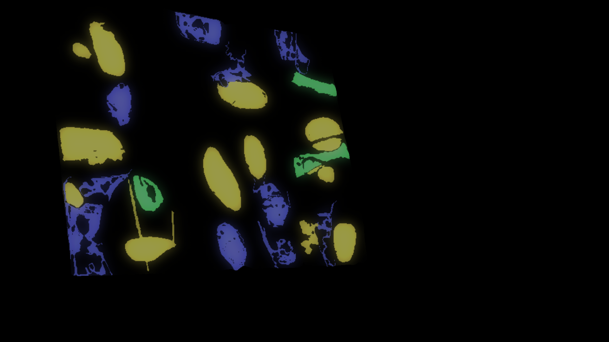
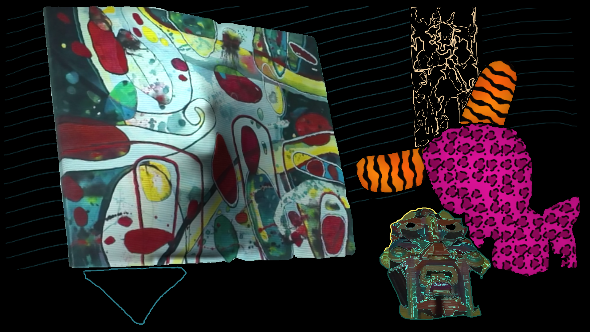

# Tu primer taller de luz

Piensa en el proyector como un pincel que pinta con luz. Puedes hacer que un cuadro
respire, que una tela parezca moverse desde adentro o que un objeto cambie de estampado.
Al apagar la proyección, la obra sigue igual.

## Primero, jugar en el computador

Pide que dejen hecha la [instalación inicial](../README.md#instalar-una-vez-en-el-mac).
Después basta abrir la carpeta del proyecto en Terminal y escribir:

```sh
source .venv/bin/activate
python scripts/demo.py
```

Se abrirá una página de control. Esta práctica tiene objetos dibujados de ejemplo;
no usa la cámara ni el proyector. La imagen pequeña muestra el resultado.

1. Busca **Efectos** y elige **cocodrilo**.
2. Enciende `contour_glow`, que dibuja un borde luminoso.
3. Prueba un color cálido y otro frío. Cambia una cosa a la vez para notar la diferencia.
4. Apaga ese efecto y prueba `texture_grid` sobre la **mesa**.
5. Usa **Apagar todo** para volver al negro. Para cerrar la práctica, vuelve a la
   terminal y presiona **Ctrl+C**.

Por ahora quédate en Efectos. **Nueva vista** se usa para mirar una escena con la
cámara, y es otro paso. Los efectos que necesitan fotos reales no funcionan en esta demo.

## Armar una escena para proyectar

Empieza con un cuadro y dos objetos, sobre una mesa o frente a una pared. Las
superficies mates y claras son más fáciles; el vidrio y los espejos reflejan la luz
en direcciones difíciles de controlar. Una tela debe quedar quieta durante el escaneo.

Apoya el proyector donde no pueda moverse. Pon la cámara a su lado, mirando los mismos
objetos. Baja un poco la luz de la pieza, sin cambiarla durante la toma. Deja libre
el camino de la luz. Mira la obra, no directamente el lente del proyector.

La primera vez conviene que alguien te ayude a conectar los equipos y dejar el
proyector como pantalla extendida. Esa preparación está en el README.

## Enseñarle dónde está cada cosa

Abre la página de control: **http://127.0.0.1:8795**. El programa debe estar encendido
para que la dirección funcione; no es una página pública.

1. Elige **Nueva vista**. Para la primera escena, usa una vista y deja apagadas las
   opciones de ensayo y de omitir el motor de efectos.
2. Cuando te pida dejar quieto el proyector, acomódalo y pulsa **Continuar**.
3. Verás franjas, luces blancas y colores. Son parte de la toma: el programa está
   buscando dónde cae la luz. No muevas nada ni pases por delante.
4. Espera el estado final. Si pide cambiar una posición, haz solo el movimiento que
   indica la pantalla, deja todo quieto y recién entonces pulsa **Continuar**.
5. Mira los objetos que aparecen en **Efectos**. Prende un contorno para comprobar
   que cae sobre el objeto correcto antes de combinar animaciones.

Si faltan objetos, si tienen nombres raros o si la luz cae fuera del borde, no es
una falla tuya. Puede faltar preparar la foto y sus recortes, o repetir la toma.
Pide a quien te ayuda que revise la [preparación de objetos](ESCENA-AUTOMATICA.md).
Si cambias los objetos de lugar o mueves el proyector, hay que volver a mirar la escena.

## Elegir una sensación

Los nombres de la izquierda son los que puedes encontrar en la galería. Algunos
requieren que la persona que prepara la escena deje lista su foto y sus recortes.

| Nombre en la galería | Qué probar | Preparación |
|---|---|---|
| `contour_glow` | Un borde luminoso suave | Objeto reconocido; funciona en la demo |
| `texture_grid` | Patrones geométricos y color | Objeto reconocido; funciona en la demo |
| `vector_drawing` | El dibujo aparece línea por línea | Foto y contornos preparados |
| `vector_pencil` | Trazos como de lápiz | Foto y contornos preparados |
| `vector_blobs` | Grandes manchas de color que cambian lentamente | Foto y recortes preparados |
| `tela_viva` | Una cara, mano o esfera parece empujar desde atrás | Cuadro con foto y recorte preparado |
| `tigre_animado`, `leopardo_fucsia` | Rayas y manchas sobre un objeto | Regiones preparadas para estos efectos |
| `surface_lines` | Líneas suaves que recorren una pared | Foto y recorte preparados |

Empieza con poca intensidad y movimiento lento. Cambia color, velocidad y fuerza
por separado. Combinar demasiados efectos puede tapar la pintura o volver lenta la imagen.



*Ejemplo guardado de `vector_blobs`: la pintura se transforma en manchas de color.
Es la imagen que se envía al proyector, no una foto de cómo se ve en la sala.*



*Ejemplo guardado de una composición: cuadro con tela, rayas, estampado fucsia y
una máscara decorativa delineada. Son objetos y obras; no hay personas ni escritorios
de computador. Estos recortes pertenecen a aquella escena y no se aplican a tu sala.*

## Pedirle cosas a la secretaria

Si ya está configurada la voz, habla con una instrucción corta y espera su respuesta:

- «¿Qué objetos estás viendo?»
- «Enciende un contorno azul en el cuadro».
- «Más lento» o «baja la intensidad de ese efecto».
- «Apaga el efecto del cuadro».
- «Guarda la idea de que las flores se abran con la música».

Pedir una idea nueva la deja anotada para desarrollarla; no significa que ya esté
creada. La voz es opcional y necesita una cuenta propia conectada a internet.
Mientras tanto puedes usar todos los controles del dashboard sin hablarle.

## Cuatro experimentos

1. **Cuadro vivo:** empieza con trazos lentos y luego agrega manchas de color. Deja
   pausas oscuras para que vuelva a aparecer la pintura original.
2. **Algo detrás de la tela:** prueba primero una esfera suave; después una mano
   o cara. Baja la fuerza hasta que se sienta como una respiración.
3. **Escultura con otra piel:** alterna rayas y manchas sobre un objeto mate.
   Conserva las zonas oscuras para que se siga leyendo su forma.
4. **Dibujo que se revela:** usa el lápiz o el trazado progresivo y compara cómo
   cambia la obra cuando aparece despacio en vez de encenderse completa.

Para responder a música hace falta configurar la entrada de sonido. No necesitas
hacerlo para estos primeros experimentos.

## Terminar y volver otro día

Pulsa **Apagar todo**. Cierra los programas con Ctrl+C en sus terminales; apagar los
efectos no apaga el proyector. Anota el nombre del efecto, objeto, color y valores que
te gustaron: no todos los controles guardan automáticamente una composición.

Si la instalación sigue en el mismo lugar, quien la preparó puede abrir la sesión
guardada. Si algo cambió de posición, haz una nueva toma. La demo siempre está
disponible para practicar sin montar nada.
