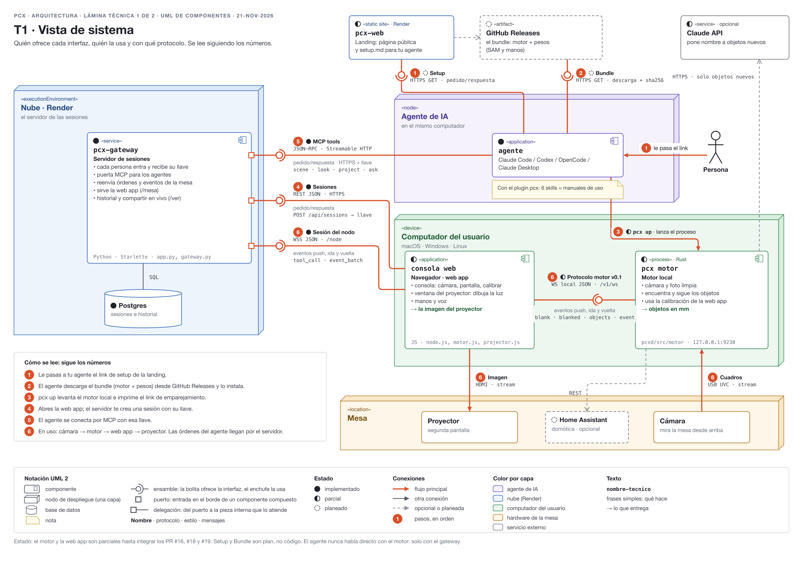
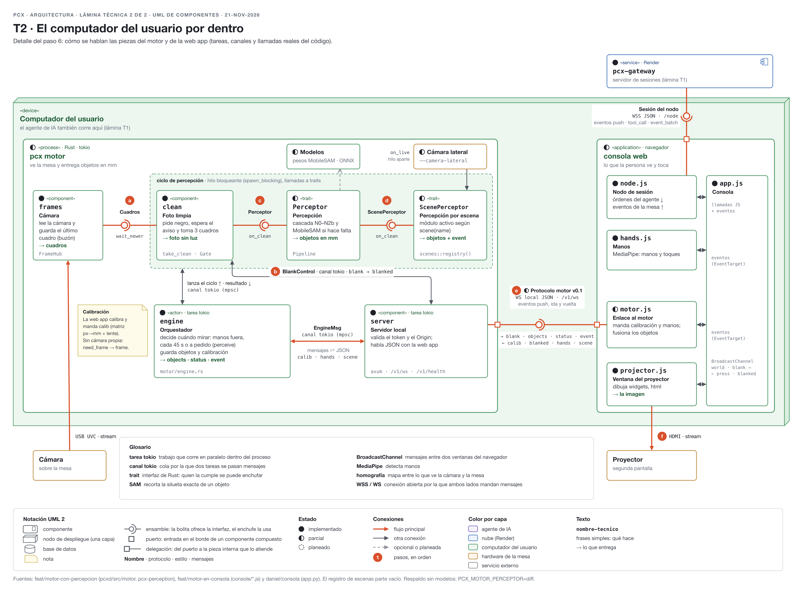
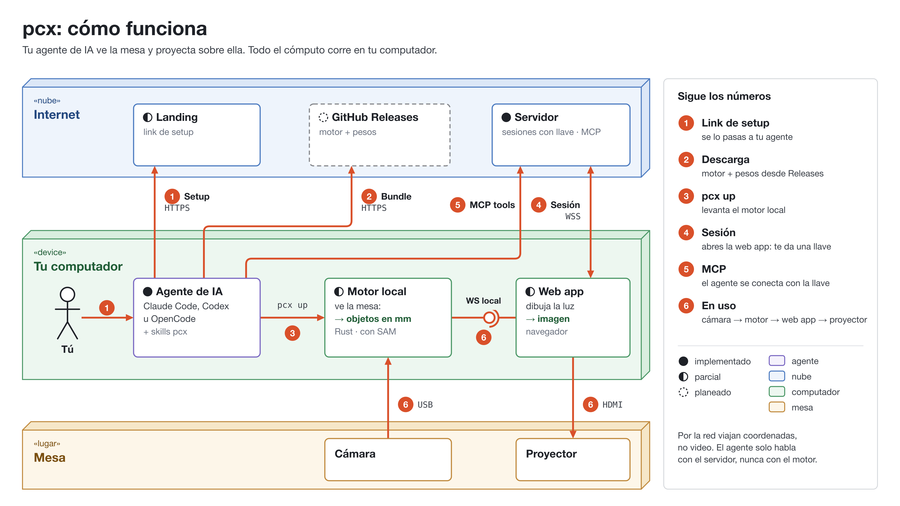
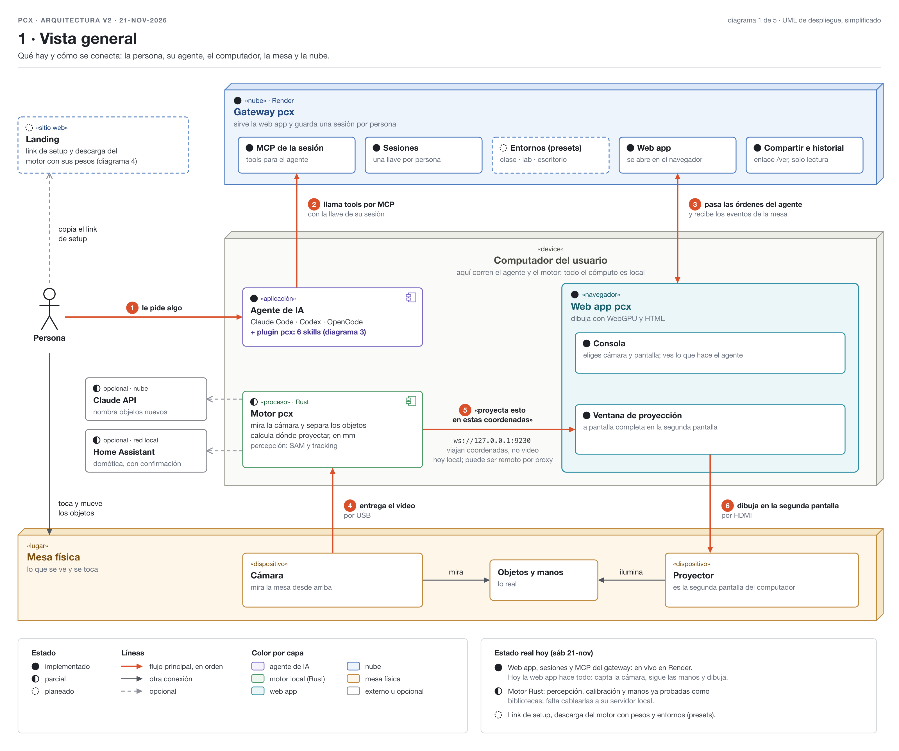
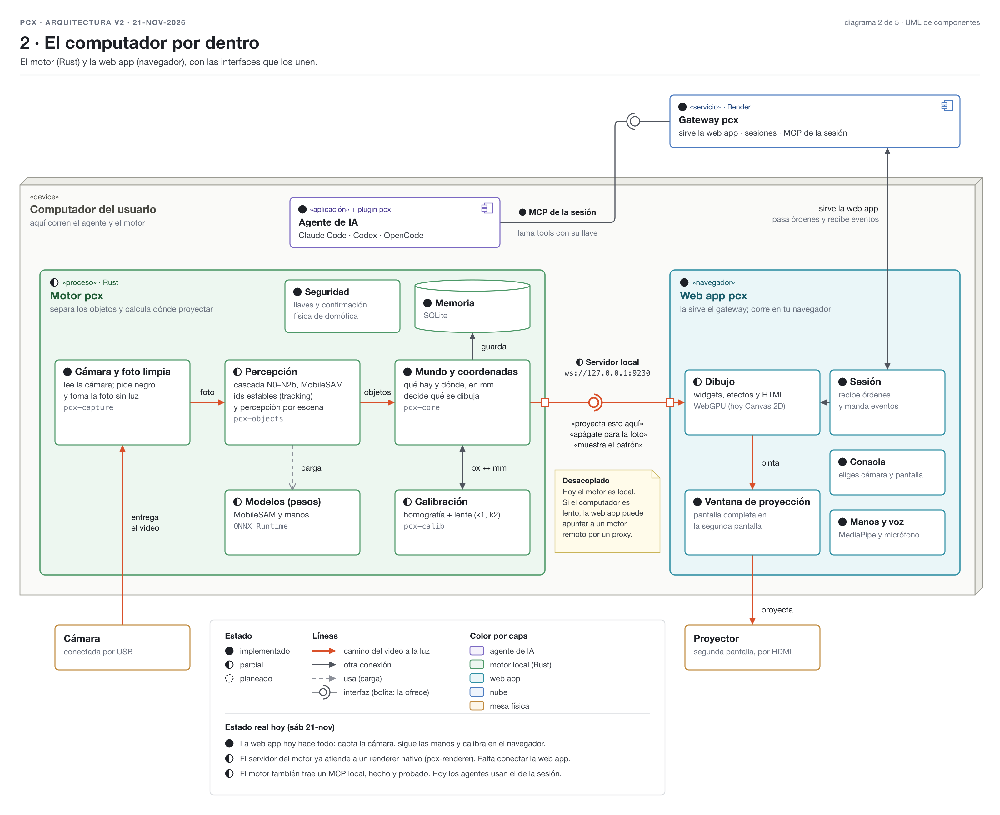
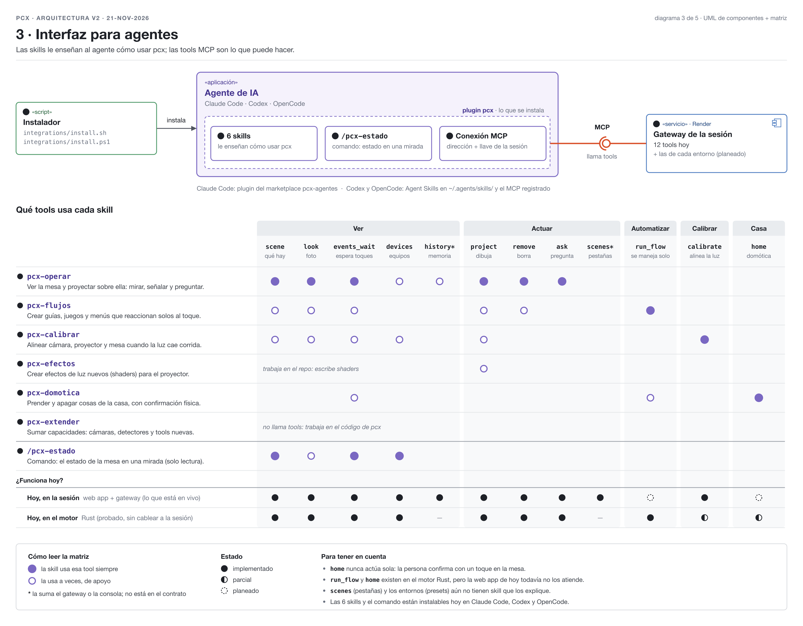
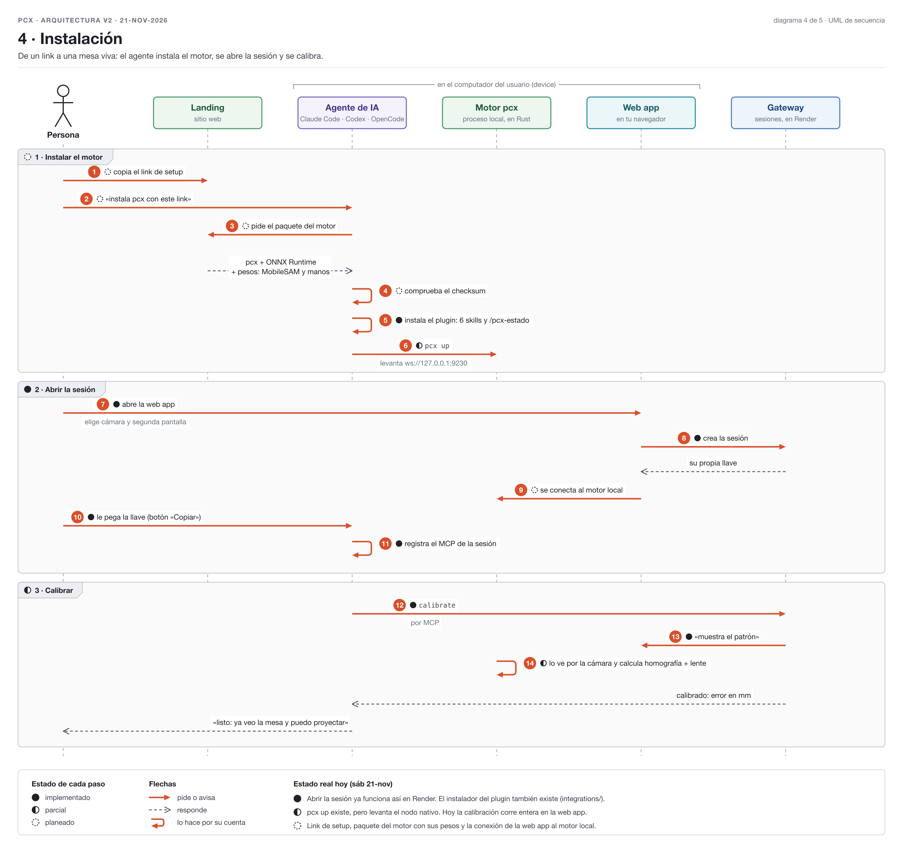
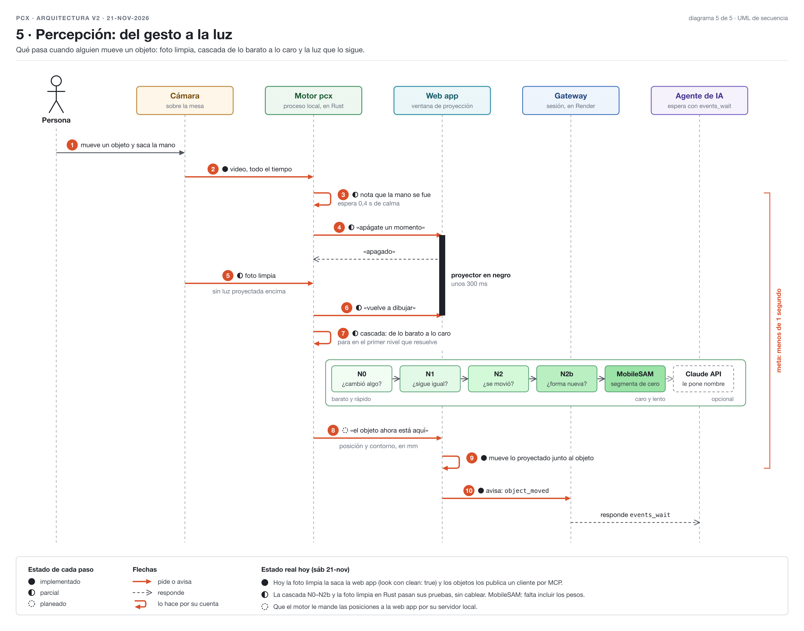

# Arquitectura de pcx

De sl-scanner (engine de Max) a pcx: contexto físico para agentes de IA. Manu decide; Claude y Codex implementan y se revisan entre sí.

Diagramas según la decisión de la reunión del sáb 21-nov, 17:16: motor Rust local + web app + gateway de sesiones. Cada uno marca qué está implementado, parcial o planeado.

## Láminas técnicas (UML de componentes)

Estilo de la v1: un nodo por capa, flujo principal en rojo y cada conexión con su interfaz, protocolo y mensajes. Se leen siguiendo los números ①–⑥. El interior sale del código (`feat/motor-con-percepcion`, `feat/motor-en-consola`, `daniel/consola`).

## Lámina para PPT (16:9)

## Vista simple

| Archivo | Qué es |
|---|---|
| [ESTADO.md](ESTADO.md) | **Estado actual**: qué está hecho, probado y pendiente |
| [ARQUITECTURA-ACTUAL.md](ARQUITECTURA-ACTUAL.md) | Arquitectura vigente (decisiones tomadas) |
| [diagramas/arquitectura-pcx-tecnico.pdf](diagramas/arquitectura-pcx-tecnico.pdf) | Las 2 láminas técnicas en un PDF |
| [diagramas/arquitectura-pcx.pdf](diagramas/arquitectura-pcx.pdf) | Los 5 diagramas de la vista simple en un PDF. Fuente: `diagramas/generar.py`; regenerar con `diagramas/render.sh` |
| [diagramas/v1/](diagramas/v1/) | Diagramas anteriores (nodo Rust + cerebro en Render) |
| [01-ENGINE-ACTUAL.md](01-ENGINE-ACTUAL.md) | Análisis del engine de Max: qué funciona, mediciones, bugs |
| [02-CASOS-DE-USO.md](02-CASOS-DE-USO.md) | Capacidades (C1–C9) y casos de uso (A–G) |
| [03-ARQUITECTURA-PROPUESTA.md](03-ARQUITECTURA-PROPUESTA.md) | Propuesta inicial (histórica; manda ARQUITECTURA-ACTUAL) |
| [MOTOR-LOCAL.md](MOTOR-LOCAL.md) | Motor local `pcx motor`: cámara → foto limpia → objetos, servidos a la web app (decisión del sáb 17:16) |
| [PROTOCOLO-ESCENA.md](PROTOCOLO-ESCENA.md) | Protocolo renderer ↔ core (v0; vigente en `contracts/`) |
| [informes/](informes/) | 8 informes de lectura completa del engine de Max |
