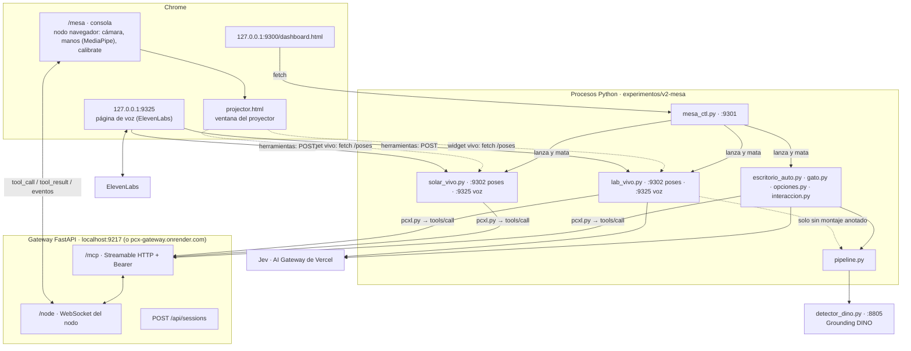
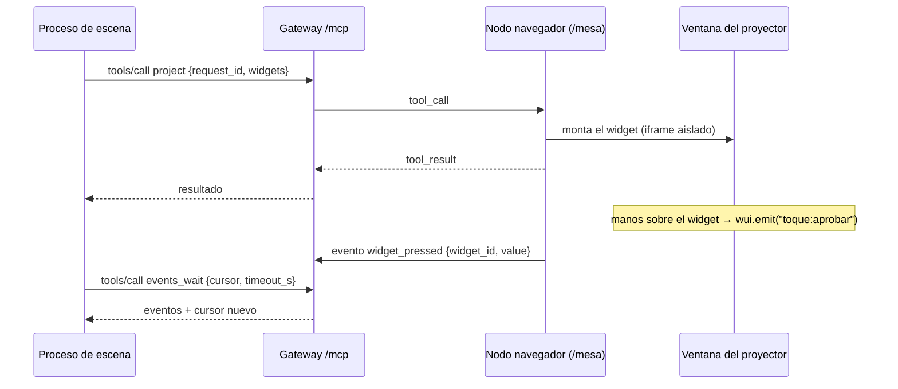
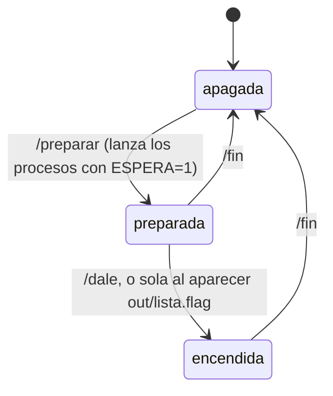

# Arquitectura de WUI (mesa v2.1)

Describe lo que corre en la demo de las tres escenas, leído del código en `daniel/v2.1` (commit `03eaf5b`). El motor
Rust (`pcx`) tiene su propia documentación en [docs/arquitectura/](../arquitectura/README.md) y no participa en esta
demo: debe estar detenido, porque apaga la proyección para tomar su foto limpia.

## Vista general



## Puertos

| Puerto | Quién escucha | Para qué |
|---|---|---|
| **9217** | Gateway local (`python -m pcx_gateway` con `PORT=9217`) | MCP en `/mcp`, consola en `/mesa`, ventana del proyector, WebSocket del nodo en `/node`, sesiones en `/api/sessions`. El puerto por defecto del gateway es 9210; 9217 es el que usan los scripts de la mesa. |
| **9300** | `python3 -m http.server 9300 --bind 127.0.0.1` lanzado a mano en la carpeta `v2-mesa` | Archivos estáticos: `dashboard.html`, `presentacion.html` y todo `out/` (imágenes de etapas, `estado.json`, `objetos.json`). Ningún script lo lanza. |
| **9301** | `mesa_ctl.py` | Control de la demo: `/preparar`, `/dale`, `/fin` (o `/stop`), `/start`, `/estado`. Responde JSON con CORS abierto. |
| **9302** | `solar_vivo.py` o `lab_vivo.py` (clase `Poses`) | Estado en vivo de la escena (`/poses`) que el widget proyectado lee unas 16 veces por segundo. |
| **9325** | `solar_vivo.py` o `lab_vivo.py` (clase `Voz`) | Página de la conversación de voz, URL firmada (`/signed`) y resolución de herramientas del agente de voz. |
| **8805** | `scripts/detector_dino.py` de `sl-scanner` | Detección con Grounding DINO: `POST /detect`. No está en este repositorio. |

Todos menos el gateway escuchan solo en `127.0.0.1`. Sistema solar y laboratorio comparten 9302 y 9325, así que no
pueden correr a la vez; `mesa_ctl.py` mata la escena anterior antes de preparar otra.

## Gateway, sesiones y MCP

El gateway (`cloud/gateway/src/pcx_gateway/`) hace tres cosas:

1. **Sesiones.** Con `PCX_OPEN_SESSIONS=1`, `POST /api/sessions` crea un usuario, un espacio y un nodo con tokens
   propios y devuelve `session_id`, `node_id`, `node_token` y `user_token`. La mesa se abre en
   `<base>/mesa#s=<session_id>.<node_token>.<user_token>`.
2. **Nodo navegador.** La pestaña `/mesa` entra al gateway como nodo por WebSocket (`/node`). Ahí viven la cámara, las
   manos, la calibración y la ventana del proyector (`projector.html`).
3. **MCP.** `/mcp` es Streamable HTTP sin estado con `Authorization: Bearer <user_token>`. El gateway responde solo
   algunas tools desde su espejo (`devices`, `events_wait`, `history`) y reenvía al nodo las demás (`look`, `project`,
   `remove`, `calibrate`, `ask`, `run_flow`, `home`). El gateway local de la demo lista 13 tools: las once anteriores
   más `scenes` y `present` (verificado con `tools/list` el 22-nov).



Hay dos gateways posibles:

- **Desplegado**: `https://pcx-gateway.onrender.com` (Render, desde `main`). Sirve para conectar un agente a una mesa
  sin instalar nada. `https://pcx-gateway.onrender.com/agente` entrega los pasos en texto plano.
- **Local**: `localhost:9217`. Es el que usa la demo, por dos razones: latencia, y que la consola local lleva el cambio
  de `consola-local.patch` (ver abajo).

### El cliente `pcxl.py`

Los procesos de la mesa no hablan MCP con una biblioteca: lanzan `/usr/bin/python3 <ruta>/pcxl.py <tool> '<json>'`, un
cliente de 20 líneas que hace `tools/call` contra `http://localhost:9217/mcp` y lee el token de un archivo `local-token`
ubicado junto a él. `escritorio_auto.py` además hace la misma llamada dentro de su proceso (`rapido()`, unos 20 ms en
vez de unos 200) leyendo ese mismo archivo.

La ruta de `pcxl.py` está escrita como constante absoluta en 18 archivos y apunta a un directorio temporal de la
máquina de origen. Es la principal deuda de portabilidad; ver [skills/wui/SKILL.md](../../skills/wui/SKILL.md).

## Widgets html y el objeto `wui`

Casi todo lo proyectado es un widget de tipo `effect` con `shader: "html"`
(`cloud/gateway/src/pcx_gateway/console/html-layer.js`):

```json
{"type": "effect", "id": "mi-widget", "shader": "html", "rect_mm": [0, 0, 1000, 563],
 "params": {"html": "<canvas id=\"c\"></canvas>", "css": "…", "js": "…"}}
```

- Cada widget es un iframe aislado (`sandbox="allow-scripts"`, origen opaco) montado sobre el canvas del proyector.
  Dentro, 1 px de CSS equivale a 1 unidad del canvas.
- Sin `params.js` es estático: no corre código del agente y solo puede cargar imágenes `https:`. Un elemento con
  `data-press="nombre"` emite `widget_pressed` al tocarlo.
- Con `params.js` es un **widget vivo**: el script corre dentro del iframe, sin red, y habla con la consola por el
  objeto `wui`:

| API | Qué hace |
|---|---|
| `wui.onHands((hands, msg) => …)` | Unas 30 veces por segundo. Cada mano trae `tip`, `palm`, `pinch`, `inside`, `handed` y `points`, en coordenadas del widget. |
| `wui.emit(valor)` | Manda `widget_pressed{widget_id, value}` al agente. Máximo 10 por segundo y 500 caracteres. |
| `wui.size` | `[ancho, alto]` del widget. |
| `wui.onAudio(({freq, level}) => …)` | Espectro del micrófono (128 bandas y nivel de 0 a 1), nunca audio crudo. El Sol reactivo lo usa. |

Si el script deja de dar señales de vida por 4 s, la consola lo detiene.

Las escenas usan estos eventos como protocolo propio: `manos_capa.py` emite `toque:<zona>` y `sobre:<objeto>`;
`solar_vivo.py` espera `planeta:<id>` y `lumo:hablar`; `lab_vivo.py` espera `voz:hablar` y `exp:iniciar`. Los procesos
los leen con `events_wait` buscando el texto dentro del evento.

### Dos sistemas de coordenadas

El canvas del gateway mide **1000 × 563** unidades (lo que la consola llama «mm» después de `calibrate`). La mesa real
mide **1406 × 706 mm**. Las escenas trabajan en milímetros reales y convierten al canvas con la homografía
`mm_to_canvas` de `fp-metric.json`; por eso todos los widgets usan `rect_mm: [0, 0, 1000, 563]` (canvas completo) y
dibujan adentro ya transformados. Detalle en [PIPELINE.md](PIPELINE.md).

## El cambio local: `consola-local.patch`

`experimentos/v2-mesa/consola-local.patch` modifica dos archivos de la consola y **no está aplicado en el
repositorio** (ni en `main` ni en esta rama):

1. `html-layer.js`: agrega `connect-src http://127.0.0.1:9302` a la política de seguridad de los widgets vivos. Sin
   esto, el widget de sistema solar y el de laboratorio no pueden leer `/poses` y no dibujan nada que se mueva.
2. `projector.js`: una ventana que ya llena la pantalla cuenta como pantalla completa (`fills()`), y se esconde el
   botón. Sirve para que `calibrar.py` y `frente.sh` pongan la ventana a pantalla completa con AppleScript.

Consecuencia: sistema solar y laboratorio **no funcionan contra el gateway desplegado**; necesitan un gateway local
parchado. En la máquina de origen el gateway local corre desde otro worktree que tiene el parche aplicado sin commitear.

Aplicarlo: `git apply experimentos/v2-mesa/consola-local.patch` desde la raíz, y recargar la ventana del proyector.
En esta rama `git apply --check` pasa (verificado); aplicarlo y probarlo con las escenas no se hizo en esta revisión.

## Control de la demo: `mesa_ctl.py`

Mantiene un estado `{escena, fase, ultima}` con fases `apagada → preparada → encendida`.



- **Preparar** mata todo, borra los widgets conocidos y lanza los procesos de la escena con `ESCENA=<nombre>` y
  `ESPERA=1`. Cada proceso detecta o rastrea sin mostrar nada y, cuando está listo, escribe `out/lista.flag`.
- Por defecto `/preparar` **lanza sola** la escena en cuanto aparece `out/lista.flag` (espera hasta 60 s). Con
  `/preparar?manual=1` se queda esperando un `/dale`.
- **Dale** proyecta la animación de arranque (widget `boot` con el logo), espera el tiempo de la escena (2,3 s
  escritorio, 1,2 s sistema solar, 1,6 s laboratorio) y escribe `out/visible.flag`, que es la señal para que los
  procesos muestren la escena.
- **Fin** hace `pkill -f` de cada script, quita los widgets y borra las banderas.

Procesos por escena (`PROC` en `mesa_ctl.py`):

| Escena | Procesos |
|---|---|
| `escritorio` | `escritorio_auto.py`, `gato.py`, `opciones.py`, `interaccion.py` |
| `solar` | `solar_vivo.py` |
| `lab` | `lab_vivo.py` |

Los registros quedan en `out/<proceso>.log`.

## Comunicación entre procesos por archivos

La carpeta `out/` (no versionada; hay que crearla) es el bus entre procesos:

| Archivo | Quién escribe | Quién lee |
|---|---|---|
| `out/objetos.json` | `pipeline.py` | `escritorio.py`, `manos_capa.py`, `gato.py`, `opciones.py`, `lab_vivo.py` |
| `out/zonas.json` | `escritorio.py` | `manos_capa.py`, `interaccion.py` |
| `out/esc-id.txt` | `escritorio_auto.py` | `escritorio.py` (id del widget vigente para el relevo sin parpadeo) |
| `out/lista.flag`, `out/visible.flag` | procesos de escena, `mesa_ctl.py` | `mesa_ctl.py`, procesos de escena |
| `out/gato-juego.flag` | `interaccion.py` | `gato.py` |
| `out/estado.json`, `out/1-camara.jpg` … `out/4-mascaras.jpg` | `pipeline.py` | `dashboard.html` |
| `out/lumo-agente.json`, `out/lab-agente.json` | `lumo_agente.py`, `lab_agente.py` | `solar_vivo.py`, `lab_vivo.py` |
| `out/solar-poses.json` | `solar_vivo.py` | `solar_vivo.py` (reconocer los platos al volver a encender) |

## Voz

`lumo_agente.py` y `lab_agente.py` crean o actualizan un agente de ElevenLabs cada uno, copiando la configuración de
voz de los agentes de Max (solo lectura) y cambiando prompt, saludo y herramientas. El id queda en `out/`.

En marcha, `solar_vivo.py` (y `lab_vivo.py`, que reutiliza sus clases) sirve en `:9325` una página que usa
`@elevenlabs/client` desde un CDN. La página pide una URL firmada a `/signed` (el servidor local la obtiene con
`ELEVENLABS_API_KEY`; la llave no llega al navegador) y abre la conversación. Las herramientas del agente son de tipo
cliente: la página las reenvía al proceso local, que actúa sobre el estado proyectado. El botón proyectado de «Hablar»
no abre la conversación por sí mismo: el proceso hace clic en el botón de esa página con AppleScript
(`pagina_lumo`), lo que exige que Chrome permita JavaScript desde Apple Events.

## Jev

`jevc.py` llama al modelo de decisión `typesafe-ai/jev-1.14.0` por el AI Gateway de Vercel con `AI_GATEWAY_API_KEY`.
Recibe partes (texto e imágenes) y preguntas tipadas, y devuelve probabilidades, opciones o cajas. Usos en el código:

- `escritorio_auto.py`: si hay una mano o un brazo sobre la mesa antes de rearmar la escena.
- `gato.py` y `opciones.py`: leer lo dibujado en la libreta.
- `lab_vivo.py`: verificar si el vaso tiene líquido.

Sin llave devuelve `{"error": "sin llave"}` y cada llamador sigue con un valor por defecto.
