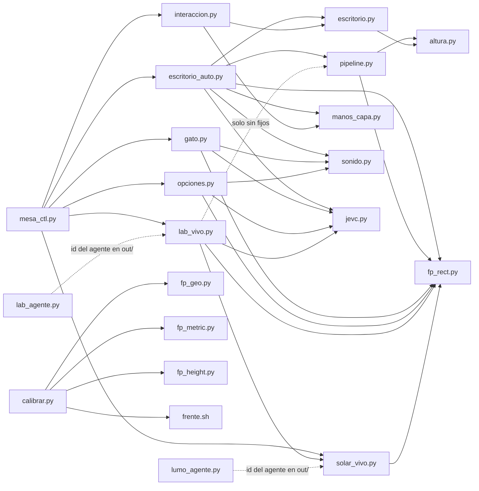

# Informe de código obsoleto en `experimentos/v2-mesa/`

Revisión sobre `daniel/v2.1` en el commit `03eaf5b`. **No se borró nada**: este documento solo lista y recomienda.

## Método

El punto de partida es lo que la demo ejecuta de verdad. `mesa_ctl.py` lanza seis scripts
(`PROC`): `escritorio_auto.py`, `gato.py`, `opciones.py`, `interaccion.py`, `solar_vivo.py` y `lab_vivo.py`. Desde ahí
se siguió cada `import` y cada `subprocess` que nombra un archivo de la carpeta, más `calibrar.py` y los dos scripts que
crean los agentes de voz, que se corren a mano. Para cada archivo se buscó quién lo nombra con `grep` sobre todos los
`.py`, `.sh`, `.html` y `.md` de la carpeta. Las funciones sin uso se buscaron contando apariciones del nombre dentro
de su archivo y en los demás.

Límite del método: es análisis estático por nombre. No detecta código que solo deja de ejecutarse por el valor de un
dato (esos casos se revisaron a mano y están en la sección de código muerto), ni usos desde fuera de la carpeta por
personas que corren un script a mano.

## Lo que sí se usa

Vivos, entonces: `mesa_ctl.py`, `escritorio_auto.py`, `escritorio.py`, `manos_capa.py`, `interaccion.py`, `gato.py`,
`opciones.py`, `solar_vivo.py`, `lab_vivo.py`, `pipeline.py`, `altura.py`, `fp_rect.py`, `fp_geo.py`, `fp_metric.py`,
`fp_height.py`, `calibrar.py`, `frente.sh`, `jevc.py`, `sonido.py`, `lumo_agente.py`, `lab_agente.py`,
`dashboard.html`, `presentacion.html`, y los datos `fp-metric.json`, `fp-geo.json`, `cal-local.json`,
`lab-modelo.json`, `solar-modelo.json`, `planetas.json`, `prompts-escritorio.json`, `prompts-lab.json`, `cues/`, `marca/`.

## Archivos obsoletos o reemplazados

| Archivo | Líneas | Qué era | Evidencia | Recomendación |
|---|---|---|---|---|
| `capas.py` | 251 | Capas que siguen libreta, lámina y caja de viales, con «foco de luz negra» para medir (v2). | Ningún script lo importa ni lo lanza; solo lo nombra `README.md`. Su seguimiento lo reemplazaron `escritorio_auto.py` (rearmado sin apagar) y `solar_vivo.py`. Sin cambios desde el primer commit de la carpeta (`47f3e1b`). | **Archivar.** La técnica del foco negro local está documentada en el `README.md` de la carpeta y puede servir de referencia. |
| `escenas.py` | 73 | Barra lateral de escenas activada con la mano; cambiaba de escena. | Solo lo nombra `V2.1.md`, que ya dice que la barra «quedó fuera». Lo reemplazó `mesa_ctl.py`. Sus escenas «laboratorio» y «solar» leen `out/widget-lab.json` y `out/widget-solar.json`, estáticos. | **Borrar.** Si se quiere volver a cambiar de escena con la mano, conviene rehacerlo sobre `mesa_ctl.py`. |
| `estrellas.py` | 56 | Escena «cielo»: estrellas sobre Santiago a la hora actual. | Solo la lanza `escenas.py` (obsoleto). No está en `PROC` de `mesa_ctl.py`. El catálogo está escrito de memoria, según su propio encabezado. | **Archivar.** Es una escena completa y autónoma; no forma parte de la demo. |
| `skin_vivo.py` | 123 | Imagen generada proyectada sobre la mesa con cronómetro. | Nadie lo importa ni lo lanza; solo lo nombra `README.md`. Depende de `out/vlm.json`, que las escenas actuales no producen. | **Archivar** junto con `skin/`. |
| `skin/` (`gen_google.py`, `gen_openai.sh`, `medir.py`, `normalizar.py`, `proyectar_skin.py`, `prueba_rapida.sh`, `prompts/`, `metricas.*`, `entrada-objetos.json`) | 145 | Generación de imagen y medición de tiempos. | `gen_google.py` solo lo usan `skin_vivo.py` y `prueba_rapida.sh`. `medir.py`, `normalizar.py` y `proyectar_skin.py` no los llama nadie. Ninguna escena actual usa imágenes generadas. | **Archivar** con `skin_vivo.py`. `metricas.txt` guarda los tiempos medidos de generación, que el `README.md` cita. |
| `fit3d.py` | 48 | Ajuste de los centros ópticos de cámara y proyector usando las bolas como esferas. | Solo lo importa `fit3d_b.py`. Necesita `scipy`, que ningún archivo vivo usa. Su salida (`fp-3d.json`) no la lee nadie más. | **Archivar.** Es el único intento de calibración 3D; `altura.py` terminó usando posiciones escritas a mano y el encaje medido. |
| `fit3d_b.py` | 20 | Variante: ajusta solo el proyector. | Nadie lo importa ni lo lanza. | **Archivar** con `fit3d.py`. |
| `fp-3d.json` | — | Resultado de `fit3d.py`. | Solo lo nombra `fit3d.py`. | **Archivar** con `fit3d.py`. |
| `todo.py` | 23 | Secuencia completa de la v2: calibrar, tablero de ajedrez, contornos, modelos, planetas. | Nadie lo lanza; solo lo nombra `README.md`. Encadena `modelos.py` y `proyectar3d.py`, también fuera de uso, y deja `pipeline.py vivo` corriendo, que competiría por la cámara con las escenas. | **Borrar.** Lo reemplazaron `calibrar.py` y `mesa_ctl.py`. |
| `proyectar.py` | 11 | Proyecta los contornos de `out/objetos.json` como halos. | Nadie lo nombra, ni un documento. | **Borrar**, o mantener como utilidad de diagnóstico si se documenta: son 11 líneas y sirve para ver si la calibración calza. |
| `proyectar3d.py` | 59 | Planetas como esferas trazadas por rayos (WebGL) sobre las bolas. | Solo lo lanza `todo.py`. Lee `out/modelos.json`, que solo escribe `modelos.py`. Lo reemplazó el widget de `solar_vivo.py`. | **Archivar.** El sombreador es reutilizable. |
| `modelos.py` | 35 | Objeto segmentado → primitiva 3D (esfera, disco, cilindro, prisma). | Solo lo lanza `todo.py`. Ninguna escena lee `out/modelos.json`. | **Archivar** con `proyectar3d.py`. |
| `solar.py` | 586 | Escena de sistema solar estática («óleo nocturno»), un widget sin seguimiento. | Solo lo invoca `escritorio_auto.py` en la rama `ESC=='solar'`, y `mesa_ctl.py` nunca lanza `escritorio_auto.py` con `ESCENA=solar` (la escena `solar` lanza solo `solar_vivo.py`). `SOLAR.md` deja como pendiente «el fondo pintado de Max bajo la capa viva», que es lo que este archivo dibuja. | **Archivar.** Si se retoma el fondo pintado, se saca de aquí. |
| `laboratorio.py` | 904 | Escena de laboratorio estática: un widget armado desde cajas del agente. | Nadie lo importa ni lo lanza. Lee `out/vlm-solar-lab.json`, que no produce ningún script. Lo reemplazó `lab_vivo.py`. Es el archivo más largo de la carpeta. | **Archivar.** Tiene el lenguaje visual del laboratorio (tokens, grilla, estados) por si se quiere portar algo. |
| `preview-lab/` (8 páginas) | — | Vistas previas generadas por `laboratorio.py --preview`. | Solo las escribe `laboratorio.py`. | **Borrar**: se regeneran. Si se archiva `laboratorio.py`, van con él. |
| `preview-solar/` (4 páginas y `capturar.sh`) | — | Vistas previas generadas por `solar.py --preview`. | Solo las escribe `solar.py`. | **Borrar**, igual que las anteriores. |
| `escritorio_eventos.py` | 15 | Escuchaba toques de Aprobar y Rechazar. | Nadie lo nombra. Lo reemplazó `interaccion.py`, que escucha `toque:aprobar` y `toque:rechazar` emitidos por `manos_capa.py`. | **Borrar.** |
| `prompts-solar.json` | — | Nombres para detectar el montaje solar con Grounding DINO. | Solo se abriría con `ESCENA=solar` en `escritorio_auto.py` (rama muerta, ver abajo). `solar_vivo.py` no usa DINO. | **Archivar** con `solar.py`. |

«Archivar» significa moverlo a una carpeta aparte (por ejemplo `experimentos/v2-mesa/archivo/`) con una línea que
diga qué era, para que no confunda a quien llega a la carpeta pero siga a mano. Sumado, lo archivable o borrable son
unas 2.330 líneas de Python de un total de 5.812 en la carpeta (un 40 %).

## Código muerto dentro de archivos vivos

| Dónde | Qué | Evidencia | Recomendación |
|---|---|---|---|
| `solar_vivo.py`, `hablar()` | Todo el cuerpo después de la primera línea: voz por ElevenLabs y, si falla, la voz del Mac (`say`). | La función empieza con `return` y un comentario («sin voz propia…»). Lo que sigue no se ejecuta. Aún la llama `elegir()`. | **Borrar** el cuerpo y la llamada, y corregir `SOLAR.md`, que todavía promete la voz del Mac. |
| `solar_vivo.py`, `musica()` | Fondo sonoro generado con `ffmpeg`. | Definida y nunca llamada; el propio `main` comenta «sin música de fondo». | **Borrar.** |
| `solar_vivo.py`, `lumo_activa()` | Devuelve `E['conv']`. | Definida y nunca llamada; el código consulta `E.get('conv')` directo. | **Borrar.** |
| `lab_vivo.py`, `nivel_vaso()` (función) | Nivel por fracción oscura de la silueta. | Definida y nunca llamada. La reemplazó `nivel_altura()`. La herramienta de voz `nivel_vaso` es otra cosa y sigue viva. | **Borrar** la función. |
| `lab_vivo.py`, `mirar_tiras()` | Jev lee qué compartimentos de las tiras están abiertos. | Desde `03eaf5b` no se lanza: su hilo se cambió por `seguir_tiras()`. `ABIERTO` ya no se actualiza. | **Decidir**: borrarla, o volver a lanzarla junto a `seguir_tiras()` si se quiere el estado abierto o cerrado en vivo. `LAB.md` aún lo describe como funcionando. |
| `lab_vivo.py`, `detectar()` después del bloque `fijos` | Foto limpia, `pipeline.py --dino` y conservación de máscaras. | `lab-modelo.json` tiene `fijos`, así que la función retorna antes. También queda sin efecto la nueva detección periódica del bucle principal. | **Mantener** si se piensa volver a detectar el montaje; si no, borrar y dejar solo el montaje anotado. Hoy confunde: `LAB.md` describe este camino como el actual. |
| `escritorio_auto.py`, `componer()` rama `ESC=='solar'` | Arma el widget con `solar.py`. | `mesa_ctl.py` lanza este script solo para `escritorio`. La variable `ESC` solo valdría `solar` lanzándolo a mano. | **Borrar** junto con `solar.py`. |
| `escritorio.py`, `capa_taza()` | Capa de la taza: aro de luz, nivel y bandas. | Definida y nunca llamada. `ESCRITORIO.md` dice que la taza lleva «contorno limpio». | **Borrar**, o archivar si se quiere recuperar el diseño. |
| `gato.py`, `ocupadas()` | Clasifica cada celda como X u O por la forma de la tinta. | Definida y nunca llamada. La lectura la hace Jev. | **Borrar.** |
| `pipeline.py`, modo `vivo` y opción `--progresivo` | Bucle que rearma al quedar quieta la mesa; contornos que se prenden uno a uno. | Las escenas llaman siempre `pipeline.py una --dino --foto …`. `vivo` solo lo lanza `todo.py`. | **Mantener** `una`; borrar `vivo` y `--progresivo` cuando se borre `todo.py`. |
| `pipeline.py`, lectura de `out/vlm.json` | Cajas puestas por un agente en vez de DINO. | Con `--dino`, que es como lo llaman todas las escenas, se ignora. | **Mantener**: es una entrada alternativa legítima (un agente con visión en vez de un detector) y son pocas líneas. |
| `pipeline.py`, listas `PROMPTS` y `ES` por defecto | Nombres del montaje de la v2 (plato, bola, engranaje, arduino…). | Siempre se reemplazan con `--prompts`. | **Borrar** los valores por defecto y exigir `--prompts`. |
| `calibrar.py`, `sl()` primera línea | `shutil.rmtree(...) if False else None` | Nunca borra nada. | **Borrar** la línea. |
| `opciones.py`, encabezado | El texto del módulo es el de `gato.py`, marcado «cabecera compartida». | No describe lo que hace el archivo (menú de la libreta). | **Reescribir** el encabezado. |
| `mesa_ctl.py`, lista `WIDGETS` | Incluye `solar`, `solar-b` y `barra`. | Esos ids los creaban `solar.py` (vía `escritorio_auto.py`) y `escenas.py`, ambos fuera de uso. | **Mantener** por ahora: quitarlos de más no rompe nada y limpia restos. Revisar al borrar esos archivos. |

## Documentos desactualizados

No son código, pero llevan a error:

- `README.md` de la carpeta describe la v2 (`capas.py`, `skin_vivo.py`, `todo.py`, `proyectar3d.py`) como piezas
  vigentes y no menciona `mesa_ctl.py` ni las tres escenas.
- `V2.1.md` da como forma de lanzar `escenas.py escritorio`, y dice que las teclas son E, S y X.
- `DEMO.md` describe «Dale» como paso manual; desde `03eaf5b` el lanzamiento es automático.
- `SOLAR.md` y `LAB.md`: ver las diferencias anotadas en [ESCENAS.md](ESCENAS.md).

## Orden sugerido

1. Borrar lo que no tiene valor de referencia: `escritorio_eventos.py`, `todo.py`, `escenas.py`, `preview-lab/`, `preview-solar/`.
2. Mover a `archivo/` lo que sí lo tiene: `capas.py`, `estrellas.py`, `skin_vivo.py` y `skin/`, `fit3d*.py` y
   `fp-3d.json`, `modelos.py`, `proyectar3d.py`, `solar.py`, `laboratorio.py`, `prompts-solar.json`.
3. Limpiar el código muerto de `solar_vivo.py` y `lab_vivo.py`. Hacerlo **después** de la demo: son los dos archivos
   que están cambiando.
4. Actualizar `README.md` y `V2.1.md` de la carpeta.

Ninguno de estos pasos se probó: después de cada uno hay que encender las tres escenas.
