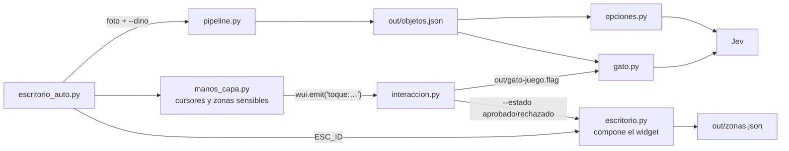

# Escenas

Las tres escenas de la mesa v2.1. Cada una tiene su documento propio en `experimentos/v2-mesa/`; aquí va el resumen,
qué procesos la componen y lo que el código dice hoy cuando difiere de ese documento.

| | Escritorio | Sistema solar | Laboratorio |
|---|---|---|---|
| Documento | [ESCRITORIO.md](../../experimentos/v2-mesa/ESCRITORIO.md) | [SOLAR.md](../../experimentos/v2-mesa/SOLAR.md) | [LAB.md](../../experimentos/v2-mesa/LAB.md) |
| Nombre en el control | `escritorio` | `solar` | `lab` |
| Procesos | `escritorio_auto.py`, `gato.py`, `opciones.py`, `interaccion.py` | `solar_vivo.py` | `lab_vivo.py` |
| Cómo percibe | Grounding DINO + MobileSAM sobre toda la mesa; rearma cuando algo cambia | Sigue tres platos por su círculo y su punto negro | Montaje anotado a mano; sigue pipeta, tiras, teléfono y nivel |
| Datos propios | `prompts-escritorio.json` | `solar-modelo.json`, `planetas.json` | `lab-modelo.json`, `prompts-lab.json` |
| Voz | Nota de voz (transcripción) | Lumo, agente conversacional | Agente conversacional formal |
| Necesita `consola-local.patch` | No | Sí | Sí |
| Necesita el servicio de detección (`:8805`) | Sí | No | No, mientras `lab-modelo.json` tenga `fijos` |
| Llaves | `AI_GATEWAY_API_KEY`, `ELEVENLABS_API_KEY` | `ELEVENLABS_API_KEY` | `ELEVENLABS_API_KEY`, `AI_GATEWAY_API_KEY` |
| Captura | `capturas/escritorio-0515-4k.jpg` | `capturas/solar-0606-4k.jpg` | `capturas/lab-estilo-4k.jpg` |

Orden de la demo: Escritorio → Sistema solar → Laboratorio. Guion y reparto en
[PITCH.md](../../experimentos/v2-mesa/PITCH.md), [HOJAS.md](../../experimentos/v2-mesa/HOJAS.md) y
[DEMO.md](../../experimentos/v2-mesa/DEMO.md).

## 1 · Escritorio

La mesa reconoce lo que hay encima y proyecta una interfaz sobre cada objeto: «Aprobar» y «Rechazar» junto al
trackpad del computador, un panel «Tus agentes», un menú radial alrededor del mouse, un aviso de batería junto al
teléfono con el recorrido hasta el cargador, el logo de Platanus envuelto en el plátano, el gato y un menú en la
libreta, y una silueta de mano para grabar una nota de voz.

- `escritorio_auto.py` es el dueño de la escena: detecta al encender y vuelve a detectar cuando algo se mueve, sin apagar la proyección.
- `escritorio.py` (893 líneas) no es un proceso vivo: se ejecuta cada vez que hay que componer el widget.
- `manos_capa.py` tampoco es un proceso vivo: proyecta un widget con script que hace todo el trabajo en el navegador.
  Una zona se dispara al posar cualquier parte de la mano 200 ms.
- `interaccion.py` escucha los toques: respuesta de aprobar o rechazar (vuelve a la pregunta a los 6 s), inicio del
  gato y nota de voz (graba 6 s con `ffmpeg`, transcribe con ElevenLabs `scribe_v1` y deja la nota proyectada 14 s).
- El gato no consulta a Jev hasta que alguien posa la mano en «Comenzar juego».

Pendiente declarado en su documento: probar con manos reales las dos manos a la vez y la nota de voz de punta a punta.

## 2 · Sistema solar

Tres platos con bolas de plumavit y un engranaje que hace de Sol. La mesa sigue los platos: al moverlos o girarlos,
los planetas proyectados van con ellos. Tocar un planeta lo marca en la lámina impresa y escribe su ficha en la
libreta. Lumo conversa por voz y usa cinco herramientas: `ver_mesa`, `senalar`, `escribir_libreta`,
`dibujar_libreta` y `borrar_libreta`. El Sol reacciona al nivel del micrófono y el plátano se dibuja como cohete.

- Un solo proceso, `solar_vivo.py`: rastrea, sirve `/poses` en `:9302`, sirve la página de voz en `:9325` y proyecta el
  widget `solar-vivo`, que lee las poses y dibuja.
- Si cambia el montaje: con la mesa sin proyección, `solar_vivo.py --modelo` vuelve a medir platos y bolas. Las bolas
  están anotadas a mano en `ANOT` y la lámina en `LAMINA`, dentro del archivo.
- La corrección por altura de las bolas es una estimación (`SOLAR_KP`, mm de corrimiento por mm de altura).

Diferencias entre `SOLAR.md` y el código actual:

- `SOLAR.md` dice que sin llave de ElevenLabs se usa la voz del Mac. Ya no: `hablar()` retorna en su primera línea
  («sin voz propia: la única voz de la escena es el agente»). Sin llave no hay voz.
- **Error en el arranque, en el commit `03eaf5b`.** `solar_vivo.py` usa la variable `perdido` en la línea 599
  (`log('lista: platos', sum(1 for q in perdido …))`) y la define cuatro líneas después. Leído el código, eso es un
  `NameError` al encender la escena, justo después de escribir `out/lista.flag`; el control la daría por lista y
  mostraría el arranque sin escena. No se ejecutó para confirmarlo (hay una demo corriendo). Arreglo: mover esa línea
  debajo de la que define `perdido`, o quitar el conteo del registro.

## 3 · Laboratorio

La mesa muestra el inventario de la caja organizadora, guía un protocolo paso a paso, sigue la pipeta, marca un error
si la pipeta entra en el vial equivocado, mide el nivel del vaso contra una meta y avisa si alguien deja un teléfono
en la mesa. Una voz formal guía el trabajo con doce herramientas (`ver_mesa`, `inventario`, `buscar`, `alumbrar`,
`apagar_luz`, `transferir`, `meta_vaso`, `nivel_vaso`, `protocolo`, `paso`, `escribir_libreta`, `borrar_libreta`).

- Un solo proceso, `lab_vivo.py`, que importa `solar_vivo` como biblioteca y reutiliza su cámara, su vista
  rectificada, el servidor de poses y la página de voz. Solo cambia qué se percibe y qué herramientas hay.
- El montaje está **anotado a mano** en `lab-modelo.json`, clave `fijos`: diez objetos con su rectángulo en milímetros
  sobre la foto `out/lab-norm.png`. Mientras exista esa clave, la escena no llama al pipeline ni a Grounding DINO.

Diferencias entre `LAB.md` y el código actual:

- La sección «Cómo detecta» de `LAB.md` (foto limpia, Grounding DINO + SAM y nueva detección cada 25 s) describe el
  camino que solo corre si se quita `fijos` del modelo. Con el montaje anotado, `detectar()` retorna antes.
- `LAB.md` dice que Jev lee qué viales de las tiras están abiertos. Desde `03eaf5b` el hilo que lo hacía
  (`mirar_tiras`) ya no se lanza; lo reemplazó `seguir_tiras`, que sigue las tiras por color pero no mira si están
  abiertas. El estado abierto o cerrado sale de `lab-modelo.json`.
- La foto del chip superpuesta fallaba con `NameError: name 'sc' is not defined` (visto en el registro de la máquina
  de origen, 07:28 y 08:23 del 22-nov). El commit `03eaf5b` define `sc`; no se volvió a probar.
- La foto `out/lab-norm.png` que usa la escena no está versionada (`out/` no va al repositorio): sin ella la foto del
  chip no aparece, y no hay sobre qué corregir los rectángulos.

## Qué comparten

- Arranque en dos tiempos (`ESPERA=1`, `out/lista.flag`, `out/visible.flag`) para aparecer al instante.
- Un widget html a canvas completo con script, más el efecto `hands` de la consola sin esqueleto ni estela.
- El logo animado `marca/wui-logo.webp` incrustado en base64 dentro del widget.
- Los cuatro sonidos de `cues/` (`aparicion`, `guia`, `confirmacion`, `recuperacion`), reproducidos con `afplay`.

## Crear una escena nueva

Pasos y un ejemplo mínimo en [skills/wui/SKILL.md](../../skills/wui/SKILL.md), sección «Crear una experiencia nueva».
