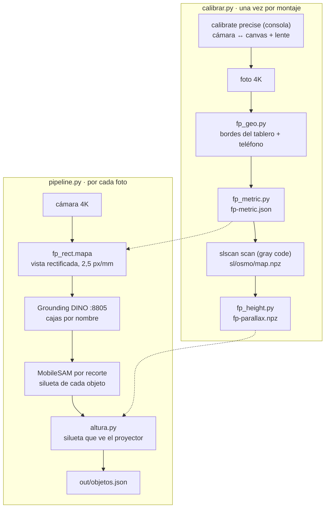

# Pipeline de percepción (mesa v2.1)

De la imagen de una cámara común a polígonos en milímetros reales, y de ahí a píxeles del proyector. Todo vive en
`experimentos/v2-mesa/`. Las cifras de este documento salen del código o de los archivos de calibración versionados;
donde algo no está medido, se dice.

## 1. Calibración (`calibrar.py`)

Un solo comando corre siete pasos y deja sus tiempos en `out/calibracion.json`:

1. **Pantalla completa**: pone en pantalla completa las ventanas de Chrome cuyo título empieza con «WUI · proyector» (AppleScript).
2. **Limpia la proyección**: lee `scene` y hace `remove` de todos los widgets.
3. **`calibrate` en modo `precise`** por MCP: la consola proyecta marcas, las busca en la cámara y guarda un modelo de
   lente (`k1`, `k2`, focal nominal) y la homografía de píxeles corregidos al canvas. El resultado se guarda en
   `cal-local.json`. La calibración versionada encontró 144 de 144 puntos y usó 140, con 1,2 px de error cuadrático medio.
4. **Foto 4K** a `hires-0.jpg` (cámara 0, AVFoundation).
5. **Marco métrico** (`fp_geo.py` y luego `fp_metric.py`), descrito abajo.
6. **Luz estructurada** (se salta con `--sin-sl`): `python -m slscan scan` de `sl-scanner` con la cámara a 3840×2160,
   y luego `fp_height.py`.
7. **Proyección al frente** (`frente.sh`).

El `README.md` de la carpeta registra unos 130 s en total, de los cuales 88 s son el `calibrate` de la consola. Esa
cifra es de la mesa anterior; no se volvió a medir en esta revisión.

### Marco en milímetros

El `calibrate` de la consola entrega coordenadas de un canvas de 1000 × 563 unidades, no milímetros reales. El marco
real se construye así:

- **`fp_geo.py`** toma la foto 4K, parte de cuatro esquinas aproximadas del tablero **escritas a mano en el archivo**
  (`A = [[564,246],[3204,216],[3735,1470],[126,1545]]`), busca el borde real cerca de cada lado, ajusta cuatro rectas
  y las cruza. Después busca el teléfono de referencia como una mancha oscura dentro de una zona fija de la foto
  (`x0,y0 = 800,760` hasta `1200,1200`) y ajusta su cuadrilátero. Escribe `fp-geo.json`.
- **`fp_metric.py`** corrige la lente, lleva el tablero a un cuadrado unidad y resuelve su ancho y alto reales usando
  que el teléfono mide **150,9 × 75,7 mm** (un iPhone XR). Escribe `fp-metric.json`:

| Clave | Qué es |
|---|---|
| `W`, `H` | Tamaño del tablero en mm. Versionado: 1406,1 × 705,7. |
| `px_to_mm` | Homografía de píxeles de cámara corregidos (referidos a 1280×720) a mm reales. |
| `canvas_to_mm`, `mm_to_canvas` | Homografías entre el canvas del proyector y mm reales. |
| `canvas_mm` | Las cuatro esquinas del canvas en mm reales. |
| `lens` | `f`, `cx`, `cy`, `k1`, `k2`. |

Origen del marco: esquina superior izquierda del tablero en la foto; x hacia la derecha de la foto, y hacia abajo.

Consecuencia práctica: **si cambia la mesa, la cámara o el teléfono de referencia, hay que editar `fp_geo.py`** (las
esquinas aproximadas y la zona del teléfono) y `fp_metric.py` (las medidas del teléfono). No hay detección automática
del tablero.

### Vista rectificada (`fp_rect.py`)

`mapa(x0, y0, x1, y1, pp, esc)` devuelve los mapas de `cv2.remap` para obtener una vista cenital de un rectángulo de
la mesa a `pp` píxeles por milímetro, aplicando la distorsión de lente. `esc` es el ancho real del cuadro dividido
por 1280, así que sirve igual con 4K o 1080p. Cada proceso elige su resolución:

| Proceso | Zona (mm) | Resolución |
|---|---|---|
| `pipeline.py` | −10…1330 × −10…700 | 2,5 px/mm |
| `solar_vivo.py`, `lab_vivo.py` | origen −10, −10 | 1 px/mm |
| `escritorio_auto.py` (detección de cambios) | −10…1330 × −10…700 | 0,5 px/mm |

La zona normalizada llega hasta x = 1330 aunque el tablero mide 1406 mm: la franja derecha queda fuera del pipeline.

## 2. Detección

`pipeline.py` tiene dos fuentes de cajas:

- **`out/vlm.json`**, si existe y no se pasa `--dino`: cajas en mm puestas por un agente mirando la foto. SAM
  segmenta solo dentro de ellas. Fue el camino de la v2 y queda como alternativa; las escenas actuales siempre pasan `--dino`.
- **Grounding DINO**: `POST http://127.0.0.1:8805/detect` con la vista rectificada a media resolución y la lista de
  nombres. El servicio (`scripts/detector_dino.py` de `sl-scanner`) carga `IDEA-Research/grounding-dino-tiny` desde la
  caché local de Hugging Face y lo mantiene en memoria.

Los nombres salen de un archivo `{"nombre en inglés": "etiqueta en español"}` pasado con `--prompts`
(`prompts-escritorio.json`, `prompts-lab.json`, `prompts-solar.json`). Filtros sobre las cajas: puntaje mínimo 0,30,
área entre 900 px² y el 30 % de la imagen, y se descarta una caja que se solape más de 0,45 (IoU) con otra de mayor puntaje.

## 3. Segmentación

Por cada caja, `pipeline.py`:

1. Recorta la vista rectificada con un margen del 18 % y escala el recorte a 1024 px de lado mayor. Segmentar **por
   recorte** le da a un objeto chico la resolución completa del modelo.
2. Corre **MobileSAM** (ONNX, `playground.appearance_prepare.MobileSAM` de `sl-scanner`) con la caja y un punto positivo
   en su centro. Para el plátano el punto es el píxel amarillo más interior, porque el centro de su caja cae fuera de él.
3. Limpia la máscara (apertura 5×5), toma el contorno mayor y descarta los de menos de 400 px².
4. Con `--dino`, filtra por forma: solidez mínima 0,72 y llenado de la caja entre 0,30 y 1,6 (0,45 y 0,18 para objetos curvos).
5. Simplifica el contorno y lo pasa a milímetros.

Cada objeto queda en `out/objetos.json` con `etiqueta`, `score`, `centro_mm`, `tam_mm`, `area_mm2` y `poligono_mm`,
más `poligono_proy_mm` cuando tiene altura (siguiente sección). Las etapas se publican como imágenes para el dashboard.

## 4. Encaje sobre objetos con altura

La cámara ve un objeto alto «acostado» hacia atrás; el proyector, que está más arriba, lo ve menos acostado. Si se
proyecta sobre la silueta de la cámara, la luz se derrama sobre la mesa. `altura.py` tiene dos soluciones.

**Estimada (`corregir`).** Solo para etiquetas que empiezan con `lata`, `taza`, `vaso` o `botella`. Estima la altura
por cuánto se alarga la silueta alejándose de la cámara y acorta la parte elevada por un factor `k`. Usa posiciones de
cámara y proyector **escritas a mano** (`CAM`, `PROY`) y un ajuste `PROY_K` (1,28 por defecto, variable de entorno).

**Medida con luz estructurada (`afin_sl`, `poli_sl`).** El escaneo gray code dice, para cada píxel de cámara, qué
píxel del proyector lo ilumina. `fp_height.py` lo convierte en dos nubes en milímetros del plano y las guarda en
`fp-parallax.npz`: `A` (dónde ve la cámara cada punto) y `B` (a dónde hay que apuntar el proyector para iluminarlo).
Sobre la mesa plana `A ≈ B`; sobre un objeto con altura difieren.

- `afin_sl(poly)`: con las muestras dentro de la silueta ajusta una transformación afín cámara → proyector (RANSAC, 3 mm
  de umbral). Devuelve `None` si hay menos de 120 muestras, si la mediana del desplazamiento es menor que 4 mm (objeto
  plano, o ya no está ahí) o si menos del 35 % de las muestras calza.
- `poli_sl(poly)`: ajuste de segundo grado, para objetos curvos. Hoy se usa solo con el plátano.
- `aplicar_sl(objs)`: aplica lo anterior a las etiquetas altas más `mouse` y `plátano`, y escribe `poligono_proy_mm`.

El encaje medido **vale mientras el objeto no se mueva desde el escaneo**. Al moverlo, el pipeline vuelve a la
estimación hasta el próximo `calibrar.py`.

Límite reconocido: la luz estructurada **no entrega alturas métricas** porque cámara y proyector están casi
alineados; entrega el desplazamiento en el plano, que es justo lo que necesita el encaje.

## 5. Seguimiento

No hay un seguidor general de objetos. Cada escena resuelve lo suyo:

| Escena | Qué se sigue | Cómo |
|---|---|---|
| Escritorio | Toda la mesa, por eventos | `escritorio_auto.py` compara la vista en gris a 0,5 px/mm. Un movimiento grande (una mano que entra) arma una revisión; cuando la mesa lleva unos 0,8 s quieta, mira dónde cambió (solo manchas con cuerpo, no trazos finos), le pregunta a Jev si hay una mano encima y, si no, corre el pipeline completo con la proyección encendida. Lo que no se movió conserva su máscara anterior. La escena nueva entra con otro id de widget y recién entonces se quita la vieja: no hay cuadro a oscuras. |
| Sistema solar | Tres platos, en continuo | `solar_vivo.py` no detecta bolas. Detecta el círculo de cada plato y su punto negro (el giro); cada bola tiene una posición fija dentro de su plato (`solar-modelo.json`). Un plato quieto queda clavado: solo se actualiza si se mueve más de 3 mm o gira más de 3°. Un plato que deja de verse por 50 lecturas apaga sus planetas. |
| Laboratorio | Pipeta, tiras de viales, teléfono, nivel del vaso | `lab_vivo.py`: el resto del montaje está anotado a mano en `lab-modelo.json` (`fijos`) y no se detecta. Las tiras se siguen por color (rangos HSV para morado y celeste) unas tres veces por segundo; el teléfono se busca en cada cuadro como una mancha oscura rectangular y salta tras tres cuadros seguidos; el nivel se mide contra la referencia del vaso tomada al partir. |

Las **manos** no pasan por este pipeline: las sigue MediaPipe Hands en la pestaña `/mesa` y llegan a los widgets por
`wui.onHands` (ver [ARQUITECTURA.md](ARQUITECTURA.md)).

Sobre la frecuencia del sistema solar: el encabezado de `solar_vivo.py` dice «≈10 veces por segundo» y un registro de
la máquina de origen muestra entre 55 y 62 lecturas por segundo, pero ese registro es de una corrida sin platos en la
mesa. No hay una medición con el montaje completo.

## Dónde mirar cuando algo sale corrido

| Síntoma | Causa probable | Qué revisar |
|---|---|---|
| Todo corrido por igual | La cámara o el proyector se movieron | Volver a correr `calibrar.py`. |
| Tamaños mal en toda la mesa | Falló la detección del tablero o del teléfono | `fp-geo.jpg` (debug que escribe `fp_geo.py`) y la línea «fono medido (mm)» de `fp_metric.py`: debe dar cerca de 75,7 y 150,9. |
| Un objeto alto con luz derramada detrás | Se movió desde el último escaneo | `calibrar.py` otra vez, o ajustar `PROY_K`. |
| Falta un objeto | DINO no lo propuso o el filtro de forma lo descartó | `out/3-deteccion.jpg` y `out/4-mascaras.jpg` en el dashboard; el archivo de nombres de la escena. |
| El pipeline no devuelve objetos | El servicio de `:8805` no está corriendo | `curl -s -X POST http://127.0.0.1:8805/detect` debe responder. |
