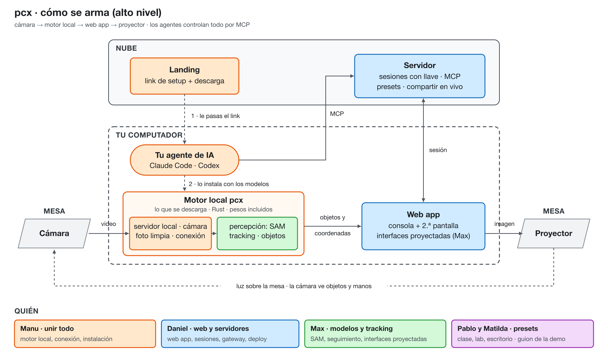
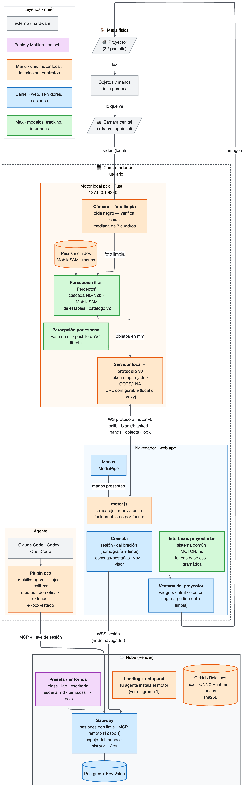

# Plan detallado de convergencia (sáb 21-nov, 18:00 → dom 22-nov, 08:30)

Basado en la decisión de la reunión de las 17:16 ([transcripción](https://github.com/satelerd/platanus-hack-26/blob/daniel/consola/docs/transcripciones/2026-11-21-1716-arquitectura-camara-proyector.md)) y en el reparto de Manu (18:00).



## Arquitectura en una línea
Cámara → **motor local pcx** (Rust, en tu compu: foto limpia, SAM, tracking) → **web app** (navegador: consola + 2.ª pantalla) → proyector. Los agentes controlan todo por **MCP con la llave de su sesión** en el servidor. El motor lo instala tu agente desde un **link de la landing**, con los pesos incluidos.



## Contratos entre piezas (dueño: Manu)
| Entre | Qué | Dónde |
|---|---|---|
| Motor ↔ web app | Protocolo v0 por WS local `ws://127.0.0.1:9230/v1/ws`: `calib`, `blank`/`blanked`, `hands`, `objects` incremental, `look`. URL configurable (local o proxy remoto) | `informes/motor/PROTOCOLO-MOTOR-v0.md`, fuera del repo; pasa a `contracts/` en v2.2 |
| Motor ↔ percepción (base y por escena, todo en Rust) | Trait Rust `Perceptor { on_clean(frame, calib, t_ns) → upsert/remove; reset() }` | `node/crates/pcx-perception/src/pipeline_api.rs` |
| Web app ↔ servidor | Sesiones, WSS del nodo y MCP (lo de hoy) | `cloud/gateway`; lo nuevo va a `contracts/` v2.2 |
| Agente ↔ servidor | MCP con la llave de la sesión + plugin pcx (6 skills) | `integrations/` |

## Hitos
| Hora | Hito | Quién |
|---|---|---|
| 19:30 | Protocolo v0 y API de percepción cerrados. PR de `motor.js` a Daniel. Max recibe la base de percepción | Manu, Daniel, Max |
| 21:00 | Motor local corriendo en la mesa con foto limpia real; cámara y proyector fijos y recalibrados | Manu + Daniel en la mesa |
| 23:00 | Objetos re-ubicados en < 1 s en la mesa | Max, Manu |
| 01:00 | **Corte de la percepción Rust.** Si no corre en la mesa, la demo usa el seguidor actual con los arreglos rápidos. Bundle v0.1 con pesos y setup por agente probado en un compu limpio | Manu, Max |
| 03:00 | Presets (clase, lab, escritorio) corriendo sobre la sesión con un agente real | Pablo, Matilda, Max, Daniel |
| 06:00 | Se congelan los deploys (`main` = lo desplegado) y se ensaya completo 2 veces | Todos |
| 08:30 | Demo | Matilda la hace, Max narra |

---

## Daniel · web, servidores y sesiones
```
DANIEL · web, servidores y sesiones

1. Revisar y mergear el PR de Manu `feat/motor-en-consola` → daniel/consola: motor.js, chico y aditivo; sin motor, todo sigue igual.
   - Negro total del proyector a pedido, para la foto limpia del motor.
   - Aviso de manos presentes o ausentes al motor.
   - Objetos fusionados por fuente: hoy `scenes objects` reemplaza todo.
   - `look` con la cámara del motor si está conectado.
2. Sesiones: guardar en la sesión la URL del motor y su token. Botón «Conectar motor local», que usa el link que imprime `pcx up`.
3. Presets/entornos en la sesión: modelo de datos y tools/endpoints MCP para que Pablo y Matilda los carguen y los agentes los usen.
4. Arreglos para la demo (auditoría y revisión de UI):
   a. /ver de solo lectura: hoy un espectador puede cambiar escenas y cámara.
   b. iframe html: un <meta refresh> saca el iframe a una página externa. Arreglo probado: sandbox="allow-same-origin" sin scripts.
   c. El toque no funciona sin el widget de manos en la escena activa.
   d. `look clean` recarga todos los iframes y deja los botones muertos un momento.
   e. Un widget anclado a un objeto ausente salta al centro: ocultarlo.
   f. `look` no se guarda por defecto.
5. Deploy: `main` como rama desplegable con checksPass; plan pago con créditos (con Key Value). Desde las 06:00, nada de deploys.
6. CORS y Local Network Access: permitir que la web app (https://…onrender.com) hable con ws://127.0.0.1:9230. Probarlo en Chrome con Manu.
Coordinar con Manu: PR de integración manu/plataforma → daniel/consola (o directo a main).
```

## Max · modelos (SAM), tracking e interfaces
```
MAX · modelos (SAM), tracking e interfaces

1. Tomar la percepción del motor: trait `Perceptor` en `node/crates/pcx-perception`. Un agente de Manu deja la base en `feat/percepcion-motor` (~19:30): cascada N0–N2b + MobileSAM solo en regiones nuevas, ids estables, histéresis, objetos finos, sin el punto fijo de SAM.
   Desde ahí es tuya: calidad, catálogo/pre-escaneo (formato catálogo v2) y nombres (Claude visión opcional; DINO fuera del camino crítico).
2. Bugs del diagnóstico (informes/tracking-diagnostico.md):
   - `seguidor_v4.py:222` recalcula el encoder en cada caja;
   - el punto positivo fijo le quita el 38 % de la máscara a la cuchara;
   - DINO queda pegado al umbral: 2 de 7 objetos entran y salen.
3. Percepción por escena EN RUST, dentro del motor (decisión de Manu, 19:00): vaso en ml (cámara lateral), pastillero 7×4, libreta. Va como módulos junto al `Perceptor`, sobre la foto limpia + los objetos del motor, sin reescribir la cascada. El Python de seguidor_v4 y MOTOR.md queda como referencia.
4. Interfaces proyectadas: el sistema común de MOTOR.md + base.css, fácil para el agente.
   - Tokens incluidos por defecto: que no tenga que pegar 4 KB en cada widget.
   - Una sola regla de tamaño (texto ≥ 28 mm).
   - Componentes: señalar, nombrar, explicar, medir, tocar.
5. En la mesa: fijar cámara y proyector (la cámara se corre ~0,75 mm/min) y medir < 1 s al mover un objeto.
Meta 23:00: objetos re-ubicados en < 1 s. Corte a la 01:00.
```

## Manu · unir todo (paquete local ↔ servidores)
```
MANU · que todo se una (paquete local ↔ servidores)

1. Motor local `pcx up` (agente en `feat/motor-local`): servidor 127.0.0.1:9230, protocolo v0, cámara propia, foto limpia orquestada (pide negro → verifica caída → mediana de 3), token de emparejamiento (0600) y URL de emparejamiento. Hospeda el `Perceptor` de Max (con `DiffOnly` de respaldo).
2. motor.js para la web app de Daniel (agente en `feat/motor-en-consola`): PR a daniel/consola, probado con un motor falso.
3. Contratos v2.2 en contracts/ (fuente única Python → Schema → Rust/TS): los 24 campos que la consola usa sin contrato (point_px, radius_mm, scenes, clean, lente, voz…) más el protocolo del motor.
4. Bundle e instalación por agente (agente en `feat/setup-agente`): release con pesos (MobileSAM + manos, sha256), install.sh/ps1, setup.md para agentes y bloque en la landing. Probar en un compu limpio.
5. Conexión motor ↔ servidores: emparejar con la sesión, motor remoto vía proxy (diseño), plugin/skills ajustados al modelo de sesiones.
6. Ramas e integración: PR manu/plataforma → daniel/consola o main, CI y diagramas.
7. 21:00 en la mesa con Daniel: primera prueba de punta a punta. Ensayo a las 06:00.
```

## Pablo y Matilda · presets y demo
```
PABLO Y MATILDA · presets y demo

1. Tres presets/entornos guardados en la sesión: clase (sistema solar), lab (pastillero 7×4 + vaso en ml), escritorio (libreta). Cada uno con escena.md: qué objetos importan, qué dice y qué muestra el agente en cada paso, y tema.css (colores y letra).
2. Probar cada preset con un agente real (Claude Code con la llave de la sesión) sobre la mesa.
3. Guion v2 y storyboard (Matilda hace la demo, Max narra), materiales físicos y 2 ensayos desde las 06:00.
```
