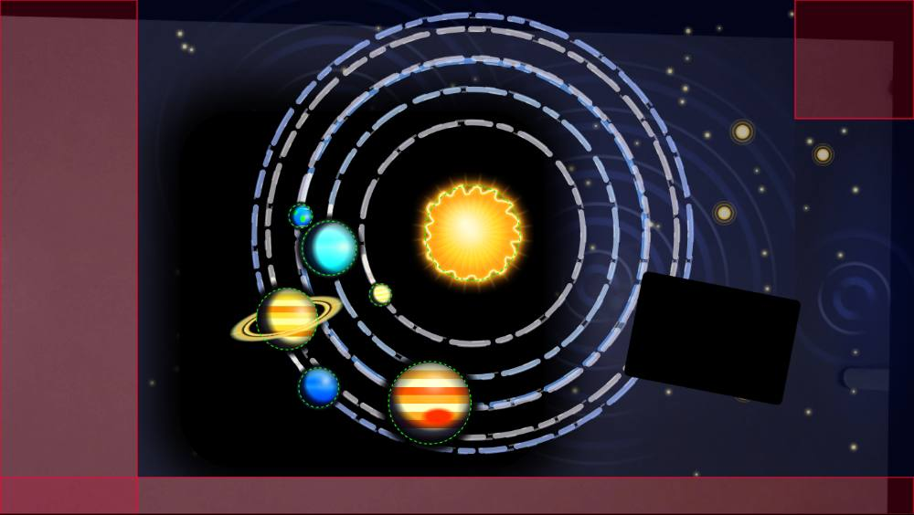

# Capa visual del Sistema solar (óleo nocturno, guion v2)

Lo que pidió Max en la mesa: fondo de espacio profundo, cada planeta como esfera 3D exactamente sobre su bola, el Sol
dentro del engranaje con su contorno como halo, y órbitas de pincel que pasan por las bolas reales. Solo dibujo: el
seguimiento, los objetos `solar:*`, la lámina, Lumo y las fichas siguen siendo los de h20.



## Enchufarlo (sin tocar `conductor.py`)

```sh
cd escenas/sistema-solar
uv run python visual/conductor_visual.py armar      # en vez de: uv run python conductor.py armar
uv run python visual/conductor_visual.py seguir     # en vez de: uv run python conductor.py seguir
uv run python visual/conductor_visual.py redibujar  # reproyecta lo ya armado con la capa nueva
```

**Para volver a armar, solo `armar` (nunca `limpiar && armar`):** los ids `solar:*` se mantienen entre armados.

Mismos comandos, variables (`PCX_MCP_URL`, `PCX_USER_TOKEN`, `PCX_CAMARA`, `PCX_SIN_OBJETOS`) y estado que
`conductor.py`. Reemplaza `widgets_sistema` y `widget_orbitas_de` con los mismos ids (`solar-sol`, `solar-orbitas`,
`solar-planeta-<id>`) y agrega `solar-fondo` y `solar-fondo-2`. Si algo de la capa nueva falla, avisa por stderr y
vuelve a los widgets de h20. Esta rama ya trae la tanda 8 de h20 (`max/escena-solar` c6dbf42): se aplica sola.

### Camino B (motor + escena `solar`): lo principal para la demo

Con `PCX_SIN_OBJETOS=1` (los `solar:*` los publica `pcx-escena-solar` en el motor, pestaña llamada exactamente
`solar`), `armar` y `redibujar` leen los objetos del mundo (`scene`) y dibujan sobre esos, no sobre la detección de
Python:

- cada `solar:<planeta>` del catálogo: esfera anclada con `anchor.object_id`, del tamaño de su `polygon_mm` y
  recortada a esa silueta (relativa a su `center_mm`), con textura, brillo y terminador;
- `solar:sol`: el Sol con su silueta; si el motor publica un círculo, se ponen ahí los dientes de la foto de `armar`;
- órbitas centradas en `solar:sol` (o en `solar:canasto` sin Sol), por el centro de cada planeta dibujado;
- lo que el motor no publica no se dibuja; el fondo y la lámina, igual que en el camino A;
- no se corre `seguir`: los objetos los mueve el motor y los widgets anclados los siguen.

Formato que consume: objetos `{id, center_mm, polygon_mm}` en mm de mesa, ids `solar:<id del catálogo>`, `solar:sol`
y `solar:canasto`. Si el motor publica una silueta real (SAM o dientes) en `polygon_mm`, se usa tal cual.

- `SOLAR_FRANJA_MM=40`: alto de la franja gris de la consola abajo (la capa no la pinta).
- `SOLAR_SIN_FONDO=1`: sin el fondo de espacio (ni la calma bajo las órbitas).

## Reglas de la mesa que cumple

| Regla | Cómo |
|---|---|
| Barra x < 150, voz [870, 0, 130, 130], franja de abajo | El fondo va en dos rects que las rodean. Las órbitas se recortan a la zona libre con 1 mm de aire y siguen ancladas con `offset_mm`, centradas donde corresponde. Con `interfaz.girada` en `mesa.json`, todo al revés |
| Sol con el contorno real | `est["sol_poligono_mm"]` de h20 (la silueta con dientes en la pose actual); si no viene, la silueta de `estado/referencia.jpg` con la máscara fina de la percepción, girada con la pose |
| Nada sobre la lámina | El widget de la lámina de h20 (z 2) pone negro sobre ella, encima del fondo y las órbitas |
| Planetas exactos sobre las bolas | Cada esfera en el `center_mm` y el `radius_mm` del objeto, sin `escala_bola` ni desplazamiento |
| Fantasmas | Lo que h20 deja un armado sin verlo (`est["fantasmas"]`, etiqueta «no la veo ahora») se dibuja atenuado y quieto, con su órbita tenue, sin sacarlo. Cuando `seguir` lo vuelve a ver y republica los objetos, solo esa esfera (y las órbitas) se re-proyecta normal |
| No re-proyectar todo en cada ciclo | `Mesa.project` descarta los widgets de esta capa idénticos al último envío; el fondo no depende de nada que se mueva. `armar` y `redibujar` mandan todo de nuevo |
| Órbitas en el Sol real o en el canasto | `centro_orbitas` de h20: el Sol si se ve; si no, el centro del canasto en la pose actual, anclado a `solar:canasto` (h20 lo publica siempre). Sin Sol, quietas |
| No ensuciar el seguimiento | `seguir` busca movimiento en el canasto + 60 mm y solo descuenta los discos y, con Sol, las órbitas. Ahí no se anima nada más: la «calma» (negro quieto bajo las órbitas) tapa el fondo, la corona del Sol no pasa de 1,3 r y el aro oscuro de cada bola no se mueve |
| Foto limpia | `look clean:true` pone negro todo lo proyectado (también el html), así que esta capa no entra en la foto limpia |

## Funciones (`visual/__init__.py`)

| Función | Qué dibuja |
|---|---|
| `fondo(superficie_mm, girada)` | Cielo ultramar con remolinos lentos y estrellas de cadmio, en dos piezas fuera de lo reservado |
| `esfera(planeta, radio_mm, hacia_sol)` | Textura saturada que gira, brillo hacia el Sol, limbo y terminador, y un aro oscuro alrededor para que la bola blanca se lea en 3D; Saturno con anillo por delante y por detrás |
| `sol(radio_mm, poligono_mm, centro_mm)` | Plasma y granulación animados recortados a la silueta del engranaje y el contorno como halo que late |
| `contorno_engranaje(img_mm, centro, radio)`, `girar_contorno(rel, centro, theta)` | La silueta dentada desde una foto limpia en mm |
| `orbitas(centro, {id: (centro, radio)}, ancla, …, zona_mm, fantasmas)` | Tres trazos de pincel por órbita por el centro de cada bola, con la calma debajo; no pintan sobre las bolas |
| `widgets(...)`, `desde_estado(est, centros)`, `fantasmas_de(est)` | Todo junto, desde lo que publica la percepción o desde el estado del conductor |

## Verlo sin mesa

```sh
uv run python visual/previa.py prueba-vivo/202855-mm.jpg /tmp/previa.html --marcas   # --luz: suma la luz a la foto
uv run pytest visual/tests                                                                   # 17 tests
```

## Sin probar

- En el proyector de verdad: probado sobre las capturas de `prueba/solar-vivo` en Chrome headless y contra las
  funciones reales de h20 (`centros_actuales`, `centro_orbitas`, `poligono_canasto`, `objetos_mundo`) con un estado
  armado desde la captura de las 20:28:55. El dibujo del fantasma no se miró en imagen (sin Chrome por memoria). Cuánto azul aguanta la mesa con luz de sala se ajusta con `--solar-fondo-opacidad` (0,62)
  o `SOLAR_SIN_FONDO=1`.
- El contorno del engranaje sale de la foto de `armar`: si el engranaje gira solo (sin el canasto), el halo no lo
  sigue hasta el próximo `armar`.
